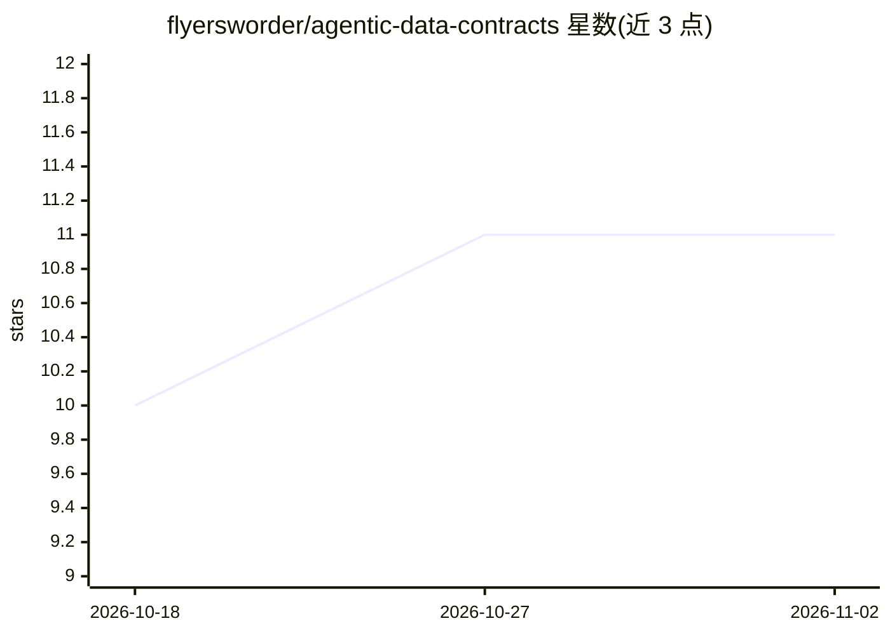

# flyersworder/agentic-data-contracts

⭐ 11 · Python · MIT · 推送 2026-10-29 · [GitHub](https://github.com/flyersworder/agentic-data-contracts) · [官网](https://pypi.org/project/agentic-data-contracts/) · 个人维护

**面向 AI agent 的 YAML 数据契约库：先教业务域规则再写 SQL**

Python 库，用 YAML 契约向 agent 预先声明业务域、指标定义与治理规则：agent 通过 lookup_domain/lookup_metric 查询受治理的语义（可从 dbt/Cube/YAML 读取），写出的 SQL 在执行前经 sqlglot 静态分析与可选 EXPLAIN 干跑校验，拦截 SELECT *、越权表、缺租户过滤等违规；提供按调用者的行列级权限、会话级成本/重试/token 预算与限时。工具为普通 async 函数，适配 Claude Agent SDK、LangChain/deepagents、Pydantic AI 或无框架使用，数据库适配 DuckDB/BigQuery/Snowflake 等可选。已知限制：to_system_prompt() 不按 principal 过滤表清单。README 附带 DABStep 四臂消融实验结果。

## 筛选速览

| 维度 | 判定 | 备注 |
|---|---|---|
| AI 角色 | `ai-ecosystem` | LLM/agent 周边工具 |
| 许可风险 | `permissive` | MIT |
| 部署形态 | `library` | 以包/库形式分发 |
| 模型依赖 | locked-api |  |
| 硬件要求 | — | 无带数字的原话,不猜 |
| 安装摩擦 | `low` | 无编译、无系统依赖或容器化 |
| 成熟度 | — | 结构信号不足 |

## 能力要点

- YAML 契约定义允许表、规则、资源限额与域目录元数据
- 查询时经 sqlglot 静态分析拦截违规 SQL（SELECT *、跨租户读、无界扫描等）
- 按调用者的表/过滤值级权限（fail-closed，匿名即拒绝）
- 工具为普通 async 函数，支持 Claude Agent SDK / LangChain / Pydantic AI / 无框架

## 适用场景

- 让数据分析 agent 使用受治理的指标定义而非自行编造 SQL
- 多用户机器人按 principal 控制可见表与过滤值
- 在 CI 中对已验证查询语料按契约与仓库 schema 变更做回归检查

## 场景标签

`数据分析` · 领域:效率与自动化

## 证据(README 行号)

> L11: You teach agents your business domains, metrics, and governance rules upfront — in YAML — instead of letting them r
> L21: - **Framework-agnostic** — plain-function tools for the Claude Agent SDK, LangChain/deepagents, Pydantic AI, or no 
> L56: **Works with:** any Python agent framework — first-class helpers for the Claude Agent SDK, LangChain / deepagents, 

## 星数曲线

2026-10-18 10 → 2026-11-02 11（+1）

---
*卡片 v1 · prompt 1.4 · 生成 2026-11-02 · 置信度 high · 依据 README sha `8dd7b6b08394` · [字段定义](../../DATASET.md)*
