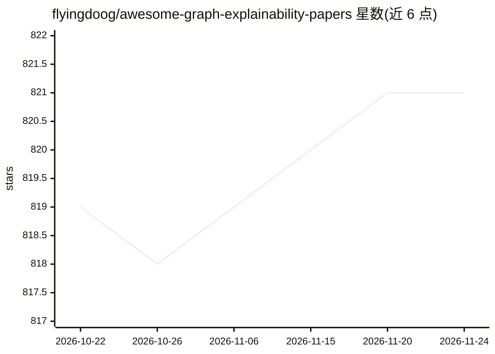

# flyingdoog/awesome-graph-explainability-papers

⭐ 821 · 推送 2026-11-12 · [GitHub](https://github.com/flyingdoog/awesome-graph-explainability-papers) · 个人维护

**GNN 可解释性研究论文策展清单（987 篇）**

收录图神经网络可解释性与可解释性相关论文的 Awesome 清单，共 987 篇，按综述、平台、年份等目录组织，条目标注发表venue并提供论文链接，部分条目附代码与文档链接。内容覆盖 GNN 解释方法、反事实解释、可信图学习、评测基准等方向。面向从事图机器学习与可解释 AI 研究的人员，欢迎社区提交 PR 补充条目。

## 筛选速览

| 维度 | 判定 | 备注 |
|---|---|---|
| AI 角色 | `ai-knowledge` | 知识聚合/清单类 |
| 许可风险 | `none` | — |
| 部署形态 | `None` |  |
| 模型依赖 | — | README 未给出锁定关系 |
| 硬件要求 | — | 无带数字的原话,不猜 |
| 安装摩擦 | `low` | 无编译、无系统依赖或容器化 |
| 成熟度 | — | 结构信号不足 |

## 能力要点

- 收录 987 篇 GNN 可解释性相关论文
- 按综述/平台/年份分类组织条目
- 部分条目附代码仓库与文档链接
- 接受社区 PR 更新

## 适用场景

- 查找图神经网络可解释性方向的入门与综述文献
- 调研某一年度 GNN 解释方法的会议论文
- 寻找可解释性评测平台与基准代码

## 场景标签

`精选清单` `科研工具` `模型评测` · 领域:评测与运维

## 证据(README 行号)

> L3:  A curated list of papers on the explainability and interpretability of Graph Neural Networks (GNNs) .
> L6:  987 papers

## 星数曲线

2026-10-22 819 → 2026-11-24 821（+2）

---
*卡片 v1 · prompt 1.4 · 生成 2026-11-24 · 置信度 high · 依据 README sha `dc103881e7fd` · [字段定义](../../DATASET.md)*
