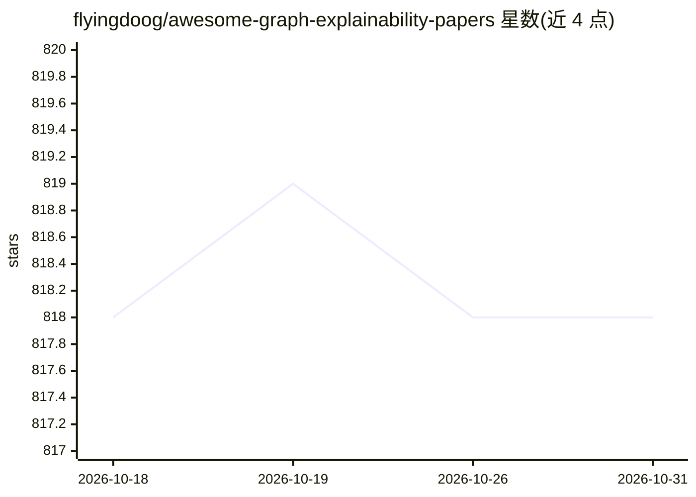

# flyingdoog/awesome-graph-explainability-papers

⭐ 818 · 推送 2026-06-03 · [GitHub](https://github.com/flyingdoog/awesome-graph-explainability-papers) · 个人维护

**GNN 可解释性论文清单：收录综述、平台与近年会议/期刊论文**

论文策展清单：按综述、平台、发表年份三个板块收录图神经网络（GNN）可解释性研究论文，条目标注发表venue（TPAMI、ICLR、WWW、AAAI、KDD 等）并附论文链接；平台板块列出 PyTorch Geometric、DIG、GraphXAI 等相关库与基准及其文档和代码入口。条目更新至 2026 年，覆盖反事实解释、因果解释、图异常检测可解释性、水印与安全等方向。仅提供链接列表，不含代码或安装方式。

## 筛选速览

| 维度 | 判定 | 备注 |
|---|---|---|
| AI 角色 | `ai-knowledge` | 知识聚合/清单类 |
| 许可风险 | `none` | — |
| 部署形态 | `None` |  |
| 模型依赖 | — | README 未给出锁定关系 |
| 硬件要求 | — | 无带数字的原话,不猜 |
| 安装摩擦 | `low` | 无编译、无系统依赖或容器化 |
| 成熟度 | — | 结构信号不足 |

## 能力要点

- 按 Surveys / Platforms / 年份三板块组织论文条目
- 平台板块附相关库与基准的文档及代码入口
- 收录 2026 年 TPAMI/ICLR/WWW/AAAI 等 venue 论文并附链接

## 适用场景

- 查找 GNN 可解释性方向的综述与最新论文
- 寻找可解释性评测平台与基准（如 GraphXAI、BAGEL）
- 按年份和发表 venue 跟踪该领域研究进展

## 场景标签

`精选清单` · 领域:学习与行业

## 证据(README 行号)

> L1: # awesome-graph-explainability-papers
> L2: Papers about the explainability of GNNs
> L4: ### Surveys

## 星数曲线

2026-10-18 818 → 2026-10-31 818（+0）

---
*卡片 v1 · prompt 1.4 · 生成 2026-10-21 · 置信度 high · 依据 README sha `0e9da703eb2b` · [字段定义](../../DATASET.md)*
