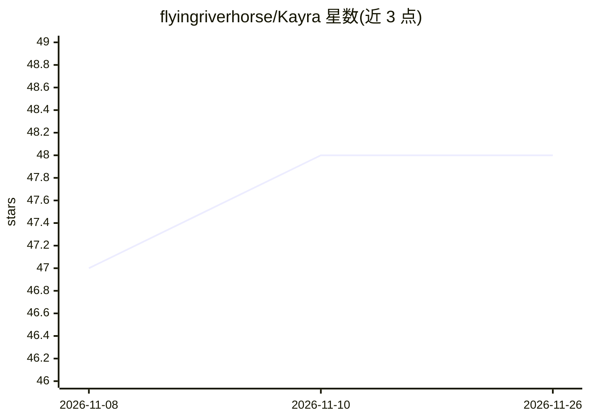

# flyingriverhorse/Kayra

⭐ 48 · Python · AGPL-3.0 · 推送 2026-11-06 · [GitHub](https://github.com/flyingriverhorse/Kayra) · [官网](http://kayra.skyulf.com/) · 个人维护

**自托管的可视化 MLOps 平台：从数据到训练、部署与漂移监控**

Kayra 是由 Skyulf 提供的自托管 Web 应用，用户上传 CSV/Excel/JSON/Parquet/S3 数据，在节点画布上拖拽构建预处理与建模流水线，后台训练与调参（34 种模型类型，含 scikit-learn、XGBoost、LightGBM），比较实验、管理版本化模型注册表并发布为 REST 端点，附带数据/模型漂移监控。核心引擎以独立 Python 库 skyulf-core（Apache 2.0，PyPI）形式提供；训练完成的模型可导出为不依赖 Kayra 的 FastAPI 服务与批处理项目，或通过 Databricks Asset Bundle 模板与 MLflow 在 Databricks 上运行完整生命周期。前后端采用 AGPL-3.0。需要 Python 3.12 或 Docker。

## 筛选速览

| 维度 | 判定 | 备注 |
|---|---|---|
| AI 角色 | `ai-ecosystem` | LLM/agent 周边工具 |
| 许可风险 | `viral` | AGPL-3.0 |
| 部署形态 | `self-host` | docker 或自建部署 |
| 模型依赖 | — | README 未给出锁定关系 |
| 硬件要求 | — | 无带数字的原话,不猜 |
| 安装摩擦 | `low` | 无编译、无系统依赖或容器化 |
| 成熟度 | — | 结构信号不足 |

## 能力要点

- 节点画布式可视化流水线：清洗、编码、特征生成、特征选择等多分支并行执行
- 版本化模型注册表与一键发布 REST 端点，保留完整部署历史
- 导出模型为独立 FastAPI 服务 + 批处理项目（含离线 wheels，不依赖 Kayra 与 PyPI）
- Databricks Asset Bundle 模板：训练、审批、Spark 批量打分、Model Serving 与漂移监控

## 适用场景

- 在自有服务器上从原始数据完成建模、部署与监控的完整流程，数据不出本机
- 把画布流水线导出为独立 API 项目或 Jupyter notebook 复用
- 在 Databricks + MLflow 上运行同一套预处理与模型的训练与批量打分

## 场景标签

`MLOps` · 领域:训练与推理

## 证据(README 行号)

> L31: - **Kayra** — a self-hosted web application. Upload data, explore it, build a pipeline on a
> L50: |**Training & tuning**|34 model types: scikit-learn classifiers, regressors and clustering, plus XGBoost and LightG
> L52: |**Registry & serving**|Versioned model registry. Promote a version and it is served behind a REST endpoint; the fu

## 星数曲线

2026-11-08 47 → 2026-11-26 48（+1）

---
*卡片 v1 · prompt 1.4 · 生成 2026-11-18 · 置信度 high · 依据 README sha `1054583f6554` · [字段定义](../../DATASET.md)*
