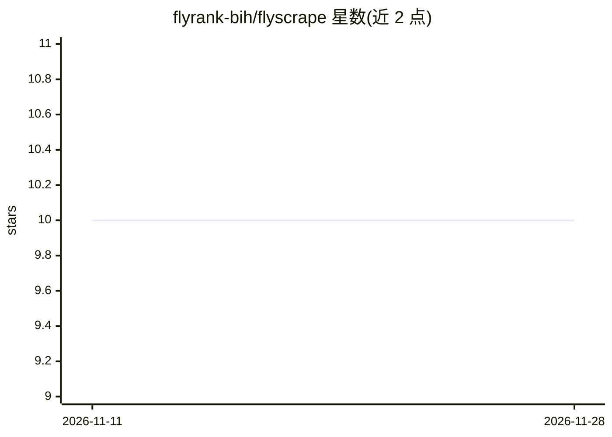

# flyrank-bih/flyscrape

⭐ 10 · TypeScript · MIT · 推送 2026-03-05 · [GitHub](https://github.com/flyrank-bih/flyscrape) · [官网](https://www.npmjs.com/package/@flyrank/flyscrape) · 组织维护

**面向 LLM/RAG 场景的 Node.js 网页爬取与抓取库**

基于 Crawl4AI 的 Node.js/TypeScript 爬虫抓取库，以 npm 包形式集成到 Web 应用。提供 Markdown 生成（含 BM25 过滤、启发式去噪、引用转换）、动态渲染抓取、无头浏览器反检测（stealth 模式、UA 轮换、TLS 指纹模拟）、会话持久化、无限滚动处理、sitemap 爬取与缓存。支持接入 OpenAI 等 LLM 按 schema 提取结构化 JSON。附带 provider-agnostic 的 REST API 服务，供 n8n 等工作流工具调用，提供 Docker 构建方式，MIT 许可。

## 筛选速览

| 维度 | 判定 | 备注 |
|---|---|---|
| AI 角色 | `ai-enhanced` | 去掉 AI 部分产品仍成立 |
| 许可风险 | `permissive` | MIT |
| 部署形态 | `self-host` | docker 或自建部署 |
| 模型依赖 | — | README 未给出锁定关系 |
| 硬件要求 | — | 无带数字的原话,不猜 |
| 安装摩擦 | `low` | 无编译、无系统依赖或容器化 |
| 成熟度 | — | 结构信号不足 |

## 能力要点

- HTML 转 Markdown：Fit Markdown 去噪、BM25 过滤、链接转编号引用
- Stealth 模式：UA 轮换、指纹保护、impit TLS 指纹模拟、会话持久化
- 按 schema 让 LLM 提取结构化 JSON 数据
- provider-agnostic REST API 服务可接入 n8n 等工作流

## 适用场景

- 为 RAG 管线抓取并清洗网页内容为 Markdown
- 给 AI agent 提供网页抓取工具
- 抓取需要 JS 渲染的 SPA 或无限滚动页面
- 为内容聚合器构建数据抓取管线

## 场景标签

`网页抓取` · 领域:效率与自动化

## 证据(README 行号)

> L11: **FlyScrape** is a Node.js package, based on top of Crawl4AI, that makes it easy to integrate powerful scrapers and
> L82: - 🧠 **AI-Powered Extraction**: Seamlessly integrate with OpenAI and other LLMs to extract structured JSON data.

## 星数曲线

2026-11-11 10 → 2026-11-28 10（+0）

---
*卡片 v1 · prompt 1.4 · 生成 2026-11-19 · 置信度 mid · 依据 README sha `774b76b2583e` · [字段定义](../../DATASET.md)*
