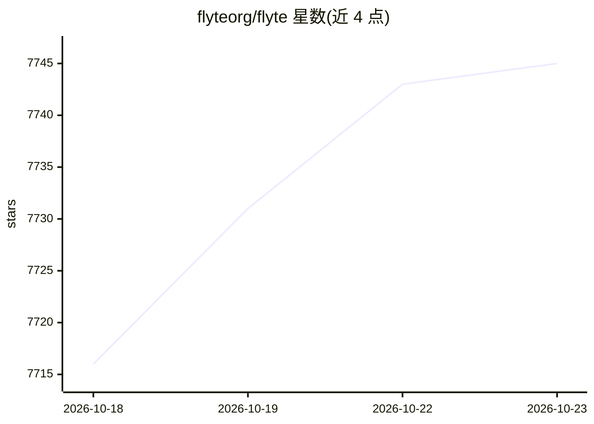

# flyteorg/flyte

⭐ 7,745 · Go · Apache-2.0 · 推送 2026-10-22 · [GitHub](https://github.com/flyteorg/flyte) · [官网](https://flyte.org) · 组织维护

**面向 ML 流水线、模型与 agent 的分布式编排框架**

Flyte 2 是 LF AI & Data 基金会毕业项目，用纯 Python（支持 async/await，另有 Rust/Go/TS）编排 ML 流水线、模型服务与 agent，面向 Kubernetes 上的分布式多节点部署。提供 flyte run 与 flyte serve 命令行运行工作流与模型服务，可用 FastAPI 构建服务；开源后端（K8s 原生）标注为 coming soon，当前生产级后端由 Union.ai 商业提供。安装方式为 pip 安装 flyte，另有 TUI 本地开发体验与 Colab 示例。

## 筛选速览

| 维度 | 判定 | 备注 |
|---|---|---|
| AI 角色 | `ai-ecosystem` | LLM/agent 周边工具 |
| 许可风险 | `permissive` | Apache-2.0 |
| 部署形态 | `library` | 以包/库形式分发 |
| 模型依赖 | — | README 未给出锁定关系 |
| 硬件要求 | — | 无带数字的原话,不猜 |
| 安装摩擦 | `low` | 无编译、无系统依赖或容器化 |
| 成熟度 | `idea` | |

## 能力要点

- 纯 Python 编排 ML 流水线、模型与 agent，支持异步
- flyte run / flyte serve 命令行运行工作流与模型服务
- LF AI & Data 基金会毕业项目，Apache 2.0 许可
- K8s 原生分布式后端（开源版标注 coming soon）

## 适用场景

- 在 Kubernetes 上编排和扩展 ML 训练与推理流水线
- 用 Python 编写类型安全的工作流并本地调试
- 将 FastAPI 模型以 flyte serve 方式提供服务

## 场景标签

`工作流自动化` `MLOps` · 领域:效率与自动化

## 证据(README 行号)

> L15: **Reliably orchestrate ML pipelines, models, and agents at scale — in pure Python.**
> L94: The open source backend for Flyte 2 is **coming soon**. This repository will contain the Kubernetes-native backend 

## 星数曲线

2026-10-18 7,716 → 2026-10-23 7,745（+29）

---
*卡片 v1 · prompt 1.4 · 生成 2026-10-20 · 置信度 high · 依据 README sha `22caf13e9593` · [字段定义](../../DATASET.md)*
