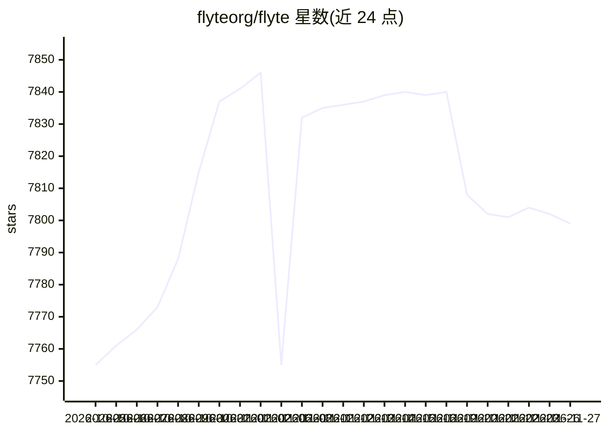

# flyteorg/flyte

⭐ 7,799 · Go · Apache-2.0 · 推送 2026-11-26 · [GitHub](https://github.com/flyteorg/flyte) · [官网](https://flyte.org) · 组织维护

**在 Kubernetes 上编排 ML 流水线、模型与 Agent 的 Python 框架**

Flyte 2 提供基于类型安全 Python（async/await）的分布式编排能力，用于运行 ML 流水线、模型服务与 Agent。本地通过 Devbox、Colab 或 GitHub Codespaces 试用，pip 安装后用 flyte CLI 运行与部署任务；后端以 Helm 部署到自建 Kubernetes 集群，生产级企业后端由 Union.ai 另行提供。项目为 LF AI & Data 基金会毕业项目，Apache 2.0 许可。

## 筛选速览

| 维度 | 判定 | 备注 |
|---|---|---|
| AI 角色 | `ai-ecosystem` | LLM/agent 周边工具 |
| 许可风险 | `permissive` | Apache-2.0 |
| 部署形态 | `library` | 以包/库形式分发 |
| 模型依赖 | — | README 未给出锁定关系 |
| 硬件要求 | — | 无带数字的原话,不猜 |
| 安装摩擦 | `low` | 无编译、无系统依赖或容器化 |
| 成熟度 | — | 结构信号不足 |

## 能力要点

- 纯 Python（async/await）编写分布式流水线，另支持 rust/go/ts
- flyte run / flyte serve CLI 运行任务与部署模型服务
- 开源后端可通过 Helm 部署到自建 Kubernetes 集群
- LF AI & Data 基金会毕业项目，Apache 2.0 许可

## 适用场景

- 在 Kubernetes 上编排大规模机器学习流水线
- 将训练好的模型以服务形式部署与运行
- 编排和管理多个 AI Agent 的工作流

## 场景标签

`工作流自动化` `MLOps` `模型训练` · 领域:效率与自动化

## 证据(README 行号)

> L15: **Reliably orchestrate ML pipelines, models, and agents at scale — in pure Python.**
> L94: The open source Flyte 2 backend is available in this repository. You can deploy it on your own Kubernetes cluster u

## 星数曲线

2026-10-25 7,755 → 2026-11-27 7,799（+44）

---
*卡片 v1 · prompt 1.4 · 生成 2026-11-22 · 置信度 high · 依据 README sha `1107372763bc` · [字段定义](../../DATASET.md)*
