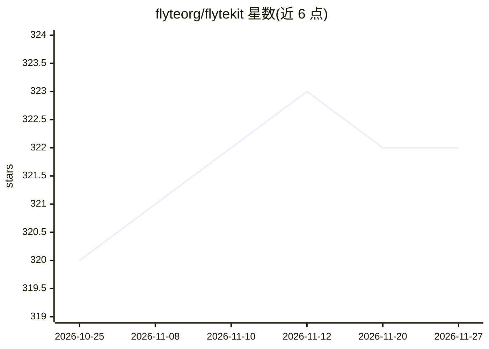

# flyteorg/flytekit

⭐ 322 · Python · Apache-2.0 · 推送 2026-11-16 · [GitHub](https://github.com/flyteorg/flytekit) · [官网](https://docs.flyte.org/en/latest/api/flytekit/docs_index.html) · 组织维护

**Flyte 工作流的 Python SDK：编写、测试、部署任务与工作流**

Flytekit 是构建在 Flyte 之上的 Python SDK，用于编写、测试、部署和交互 Flyte 任务、工作流与 launch plans，是 Flyte 生态的核心可扩展库。通过装饰器（如 @task/@workflow）声明任务并组合成工作流，支持缓存与重试配置；插件机制可扩展数据/Spark 等能力，插件列表在 plugins/README.md 维护。经 PyPI 分发，文档与示例齐备。注意：Flyte 1 将于 2026-12-31 终止生命周期，Flyte 2 已正式可用。

## 筛选速览

| 维度 | 判定 | 备注 |
|---|---|---|
| AI 角色 | `ai-ecosystem` | LLM/agent 周边工具 |
| 许可风险 | `permissive` | Apache-2.0 |
| 部署形态 | `library` | 以包/库形式分发 |
| 模型依赖 | — | README 未给出锁定关系 |
| 硬件要求 | — | 无带数字的原话,不猜 |
| 安装摩擦 | `low` | 无编译、无系统依赖或容器化 |
| 成熟度 | — | 结构信号不足 |

## 能力要点

- 以装饰器方式编写任务与工作流（task/workflow API）
- 支持任务缓存、缓存版本与重试配置
- 插件机制扩展（Spark 等主题标签对应的能力）
- 覆盖编写、测试、部署、与后端交互的完整流程

## 适用场景

- 为机器学习流水线编写可部署的 Flyte 工作流
- 以 Python 代码编排数据处理任务并交给 Flyte 后端执行
- 通过插件扩展接入 Spark 等数据场景

## 场景标签

`工作流自动化` `MLOps` · 领域:效率与自动化

## 证据(README 行号)

> L42: Flytekit Python is the Python Library for easily authoring, testing, deploying, and interacting with Flyte tasks, w
> L50: Flytekit is the core extensible library to author Flyte workflows and tasks and interact with Flyte backend service

## 星数曲线

2026-10-25 320 → 2026-11-27 322（+2）

---
*卡片 v1 · prompt 1.4 · 生成 2026-11-25 · 置信度 high · 依据 README sha `11bb69f8caf1` · [字段定义](../../DATASET.md)*
