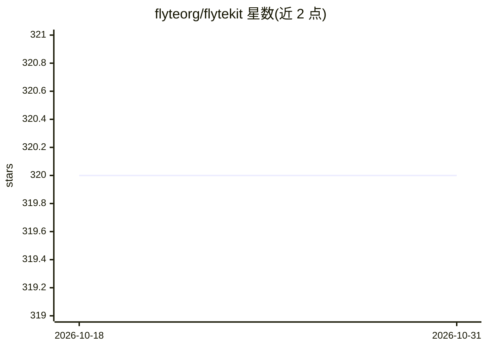

# flyteorg/flytekit

⭐ 320 · Python · Apache-2.0 · 推送 2026-10-26 · [GitHub](https://github.com/flyteorg/flytekit) · [官网](https://docs.flyte.org/en/latest/api/flytekit/docs_index.html) · 组织维护

**面向 Flyte 平台的 Python SDK：编写、测试与部署任务和工作流**

Flytekit 是构建在 Flyte 之上的 Python 库，用于编写、测试、部署 Flyte 任务、工作流和 launch plan，并与 Flyte 后端服务交互。任务以装饰器方式定义，支持缓存、重试等参数配置。通过 pip 安装，插件体系可扩展（见 plugins 目录），README 顶部声明当前内容针对 Flyte 1.x，Flyte 2 已发布并可用 Devbox 本地体验。面向使用 Flyte 平台的数据科学与 MLOps 开发者。

## 筛选速览

| 维度 | 判定 | 备注 |
|---|---|---|
| AI 角色 | `ai-ecosystem` | LLM/agent 周边工具 |
| 许可风险 | `permissive` | Apache-2.0 |
| 部署形态 | `library` | 以包/库形式分发 |
| 模型依赖 | — | README 未给出锁定关系 |
| 硬件要求 | — | 无带数字的原话,不猜 |
| 安装摩擦 | `low` | 无编译、无系统依赖或容器化 |
| 成熟度 | — | 结构信号不足 |

## 能力要点

- 装饰器方式编写 Flyte 任务与工作流
- 任务支持缓存（cache）与重试（retries）配置
- 提供插件体系扩展后端能力

## 适用场景

- 用 Python 编写可在 Flyte 上运行的数据/ML 工作流
- 在本地测试后部署任务与工作流到 Flyte 后端
- 通过插件接入 Spark 等计算后端

## 场景标签

`工作流自动化` `MLOps` · 领域:效率与自动化

## 证据(README 行号)

> L32: Flytekit Python is the Python Library for easily authoring, testing, deploying, and interacting with Flyte tasks, w
> L40: Flytekit is the core extensible library to author Flyte workflows and tasks and interact with Flyte backend service

## 星数曲线

2026-10-18 320 → 2026-10-31 320（+0）

---
*卡片 v1 · prompt 1.4 · 生成 2026-10-22 · 置信度 high · 依据 README sha `389b0a80df62` · [字段定义](../../DATASET.md)*
