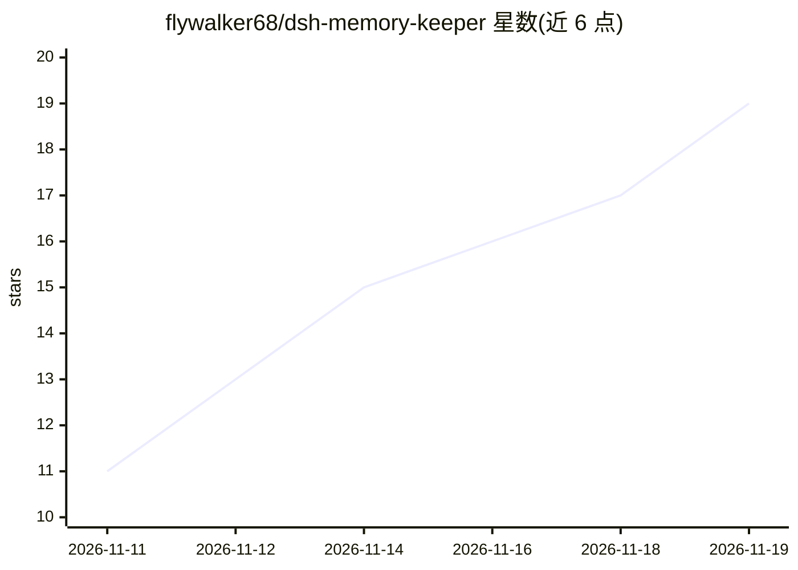

# flywalker68/dsh-memory-keeper

⭐ 19 · JavaScript · MIT · 推送 2026-11-15 · [GitHub](https://github.com/flywalker68/dsh-memory-keeper) · 个人维护 · 中文 README

**DeepSeek Harness 的长期记忆检索插件：md 记忆双路检索**

面向 DSH（DeepSeek Harness）的 cordis 插件，把人设、日记、对话记录等 md 文件变成可检索记忆：按行切块建索引，检索走词面 BM25 + 向量（本地 bge-small-zh 兜底，配百炼 key 可用 Qwen embedding + rerank）经 RRF 融合，命中后回原文件补整行与上下文；另有状态卡注入、上下文压缩后补回最近对话、记忆导入与健康检查工具。定位为检索层，不做逐轮回放、增量提取、摘要、遗忘等完整记忆系统能力。通过 git clone + npm install 并注册到 profile 安装，需 Node 24+ 与 DSH 0.2.x。

## 筛选速览

| 维度 | 判定 | 备注 |
|---|---|---|
| AI 角色 | `ai-ecosystem` | LLM/agent 周边工具 |
| 许可风险 | `permissive` | MIT |
| 部署形态 | `library` | 以包/库形式分发 |
| 模型依赖 | locked-api |  |
| 硬件要求 | — | 无带数字的原话,不猜 |
| 安装摩擦 | `low` | 无编译、无系统依赖或容器化 |
| 成熟度 | `idea` | |

## 能力要点

- 词面 BM25 + 向量 RRF 融合检索，本地 bge-small（24MB）与 Qwen embedding+rerank 双引擎自动回退
- memory_search 命中后回原文件补整行 full 与前后各一行 context，均过时间窗口过滤
- 上下文压缩后自动把最近 10 轮原话补回 system prompt
- 提供 chat_search、memory_check、persona_edit、memory_touch 工具与 Web UI 侧栏面板，支持 jsonl 对话历史一次性导入

## 适用场景

- 让 DSH 长对话中的模型通过检索找回早期记忆原文
- 把已有的日记、人设、对话记录 md 变成可按语义与时间检索的记忆库
- 离线环境下用本地小模型做记忆检索，配 API key 时升级云端 embedding+rerank

## 场景标签

`Agent 记忆` `RAG` · 领域:Agent 开发

## 证据(README 行号)

> L3: 给 DeepSeek Harness 用的**长期记忆插件**：把人设、日记、日常规则、进行中的事存成纯文本 md，检索靠「字面 + 语义」双路，右键能翻原话，还会在上下文压缩之后把最近的对话补回来。
> L17: - 这是 **DSH（DeepSeek Harness）的 cordis 插件**，**不是把目录丢进 `.dev/` 就生效**
> L89: - **检索**：`memory_search(query, top=10, beforeDate)`——词面 BM25 + 向量（本地 bge-small，或配了 key 时用 Qwen）+ RRF 融合 + 可选 Qwen r

## 星数曲线

2026-11-11 11 → 2026-11-19 19（+8）

---
*卡片 v1 · prompt 1.4 · 生成 2026-11-18 · 置信度 high · 依据 README sha `3eb826763cff` · [字段定义](../../DATASET.md)*
