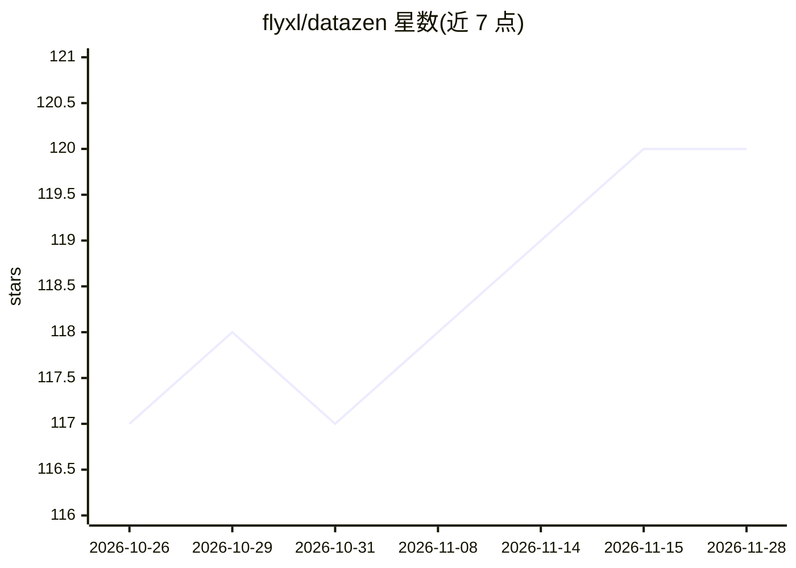

# flyxl/datazen

⭐ 120 · Rust · GPL-3.0 · 推送 2026-11-27 · [GitHub](https://github.com/flyxl/datazen) · [官网](https://flyxl.github.io/datazen/) · 个人维护 · 中文 README

**面向开发者的开源桌面数据库客户端，支持 AI 诊断与 MCP**

基于 Tauri + Rust 的桌面数据库工作台，体积小于 15MB，支持 17 种数据库驱动与 10 种界面语言，覆盖 PostgreSQL、MySQL/MariaDB、SQLite、Redis。功能包括 schema 感知的 SQL 编辑器、可视化查询构建、AI 错误诊断与 EXPLAIN 分析、图表与运维仪表盘、数据同步/迁移、YAML 工作流自动化。AI 为可选功能，支持 OpenAI、Anthropic、DeepSeek、Ollama 或任意 OpenAI 兼容端点；无需账号与云端，凭据以 AES-256-GCM 加密。同时可作为 MCP server 与 client 运行，支持 headless stdio 模式接入 agent 管道。

## 筛选速览

| 维度 | 判定 | 备注 |
|---|---|---|
| AI 角色 | `ai-enhanced` | 去掉 AI 部分产品仍成立 |
| 许可风险 | `viral` | GPL-3.0 |
| 部署形态 | `desktop` | 安装包/桌面程序 |
| 模型依赖 | local-ok | 支持本地模型 |
| 硬件要求 | — | 无带数字的原话,不猜 |
| 安装摩擦 | `low` | 无编译、无系统依赖或容器化 |
| 成熟度 | — | 结构信号不足 |

## 能力要点

- schema 感知 SQL 编辑器：补全来自真实表与列的元数据
- AI 错误诊断与 EXPLAIN 分析，生成可编辑修正 SQL
- MCP server 与 client 双角色，支持 headless stdio 运行
- 数据同步、传输、Schema Diff 均先预览再执行

## 适用场景

- 连接多种数据库，在一个桌面应用里写 SQL、看图表、做迁移
- 让 AI 基于当前连接的真实 schema 生成和诊断 SQL
- 把数据库操作写成 YAML 工作流定时执行
- 将自己的 AI agent 通过 MCP 驱动数据库查询与运维

## 场景标签

`数据分析` `工作流自动化` · 领域:效率与自动化

## 证据(README 行号)

> L5: ### The open-source database workspace for developers and AI agents
> L21: Doing real database work usually means stitching together five tools: one to browse the schema, one to write SQL, o
> L101: AI is optional and yours to configure: OpenAI, Anthropic, DeepSeek, Ollama for fully local models, or any OpenAI-c

## 星数曲线

2026-10-26 117 → 2026-11-28 120（+3）

---
*卡片 v1 · prompt 1.4 · 生成 2026-11-28 · 置信度 mid · 依据 README sha `d546db6948a3` · [字段定义](../../DATASET.md)*
