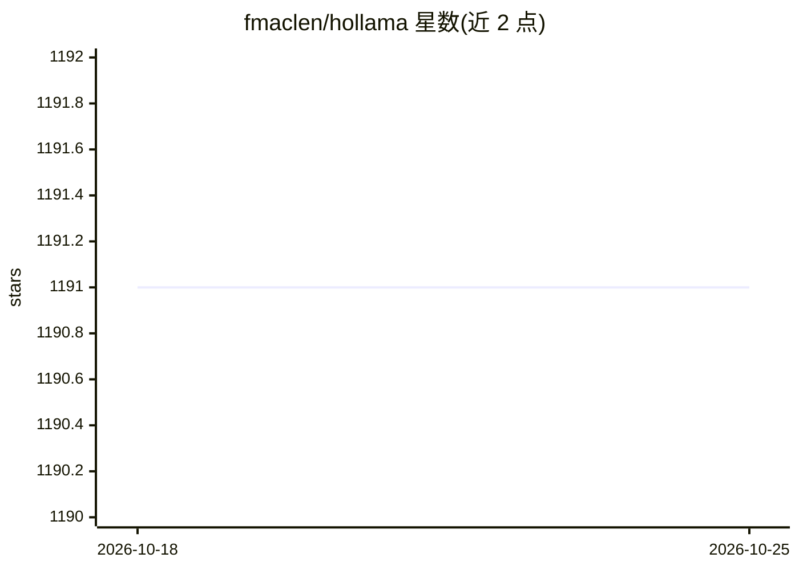

# fmaclen/hollama

⭐ 1,189 · TypeScript · MIT · 推送 2026-10-22 · [GitHub](https://github.com/fmaclen/hollama) · [官网](https://hollama.fernando.is) · 个人维护

**浏览器内运行的极简 LLM 聊天客户端，连接 Ollama/OpenAI**

纯前端本地运行的 LLM 对话应用：连接 Ollama 与 OpenAI 服务器（支持多服务器管理），覆盖文本、视觉与推理模型，提供 Markdown 渲染、KaTeX 数学公式、系统提示词定制、Ollama 高级参数及从界面直接下载 Ollama 模型。会话数据存储在浏览器本地，支持导入导出，无账号要求。提供 macOS/Windows/Linux 桌面版下载与 Docker 自托管方式。

## 筛选速览

| 维度 | 判定 | 备注 |
|---|---|---|
| AI 角色 | `ai-native` | 本体是模型或模型工具 |
| 许可风险 | `permissive` | MIT |
| 部署形态 | `None` |  |
| 模型依赖 | local-ok | 支持本地模型 |
| 硬件要求 | — | 无带数字的原话,不猜 |
| 安装摩擦 | `low` | 无编译、无系统依赖或容器化 |
| 成熟度 | — | 结构信号不足 |

## 能力要点

- 支持 Ollama 与 OpenAI 服务器，多服务器管理
- 文本/视觉/推理模型，含系统提示词与 Ollama 高级参数
- 数据存储于浏览器本地，可导入导出
- 从界面直接下载 Ollama 模型

## 适用场景

- 在浏览器里连接本地 Ollama 或 OpenAI 服务进行对话
- 多服务器切换管理不同的 LLM 后端
- 本地保存会话数据并迁移导出

## 场景标签

`聊天机器人` · 领域:对话与助手

## 证据(README 行号)

> L3: A minimal LLM chat app that runs _entirely_ in your browser.
> L7: - Support for **Ollama** & **OpenAI** servers

## 星数曲线

2026-10-18 1,191 → 2026-10-25 1,191（+0）

---
*卡片 v1 · prompt 1.4 · 生成 2026-10-21 · 置信度 high · 依据 README sha `c1f16997530a` · [字段定义](../../DATASET.md)*
