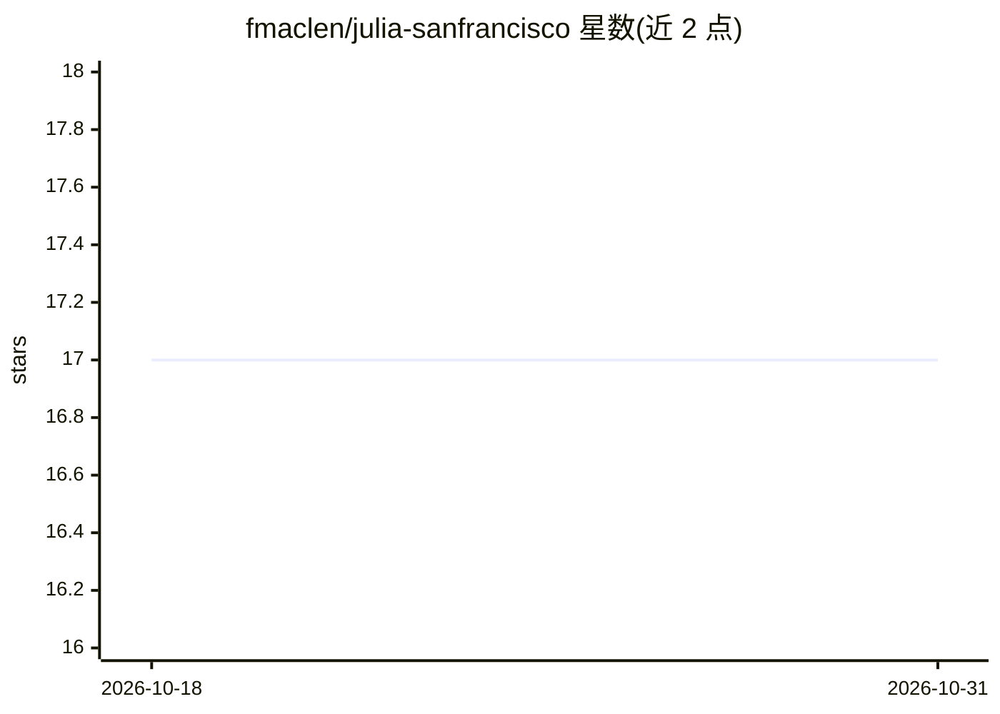

# fmaclen/julia-sanfrancisco

⭐ 17 · TypeScript · Apache-2.0 · 推送 2026-09-26 · [GitHub](https://github.com/fmaclen/julia-sanfrancisco) · [官网](https://julia.fernando.is) · 个人维护

**用生成式 AI 制作素材的 Carmen Sandiego 风格网页侦探游戏**

模仿 80 年代 MS-DOS 游戏《Where in the World is Carmen Sandiego?》的开源克隆项目：玩家追捕 Julia 及其同伙，在不同国家间解读线索、解谜并学习地理知识。项目本身作为利用生成式 AI 制作游戏及其素材的概念验证：线索文本由 OpenAI GPT-4 生成，美术素材由 Stable Diffusion（deliberate_v2 模型）生成。技术栈为 TypeScript + SvelteKit，无后端，游戏完全在浏览器运行，玩家数据本地存储；通过克隆仓库并用 bun 安装依赖后本地运行开发环境。

## 筛选速览

| 维度 | 判定 | 备注 |
|---|---|---|
| AI 角色 | `ai-enhanced` | 去掉 AI 部分产品仍成立 |
| 许可风险 | `permissive` | Apache-2.0 |
| 部署形态 | `None` |  |
| 模型依赖 | — | README 未给出锁定关系 |
| 硬件要求 | — | 无带数字的原话,不猜 |
| 安装摩擦 | `low` | 无编译、无系统依赖或容器化 |
| 成熟度 | `idea` | |

## 能力要点

- 浏览器端运行，无后端，进度与分数本地存储
- 线索文本由 GPT-4 生成
- 美术素材由 Stable Diffusion（deliberate_v2）生成
- TypeScript + SvelteKit 技术栈，可在线游玩

## 适用场景

- 在浏览器中玩地理侦探解谜游戏
- 了解生成式 AI 制作游戏素材的实践案例
- 参与开源游戏克隆的贡献开发

## 场景标签

 · 领域:游戏/娱乐

## 证据(README 行号)

> L11: **Julia Sanfrancisco** is a clone of the 80s MS-DOS game Where in the World is Carmen Sandiego?.
> L12: This project is meant as a proof-of-concept for leveraging generative AI to create the game and it's assets.
> L30: - Clues have been generated with OpenAI's `GPT-4`.
> L31: - Artwork was generated with Stable Diffusion using `deliberate_v2`.

## 星数曲线

2026-10-18 17 → 2026-10-31 17（+0）

---
*卡片 v1 · prompt 1.4 · 生成 2026-10-29 · 置信度 high · 依据 README sha `dce50a681fae` · [字段定义](../../DATASET.md)*
