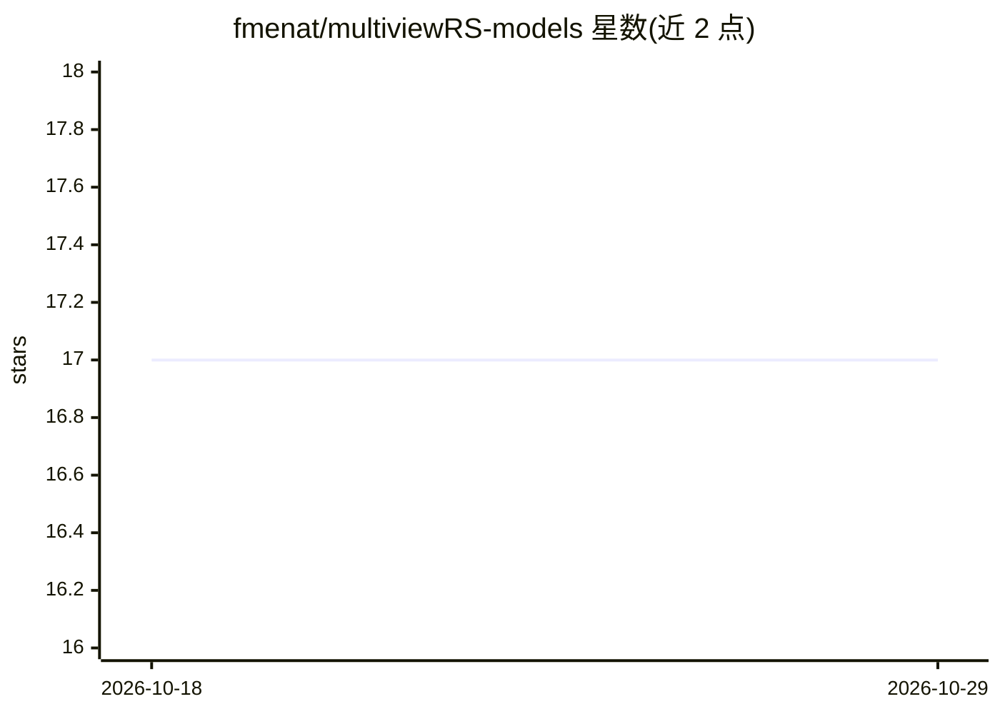

# fmenat/multiviewRS-models

⭐ 17 · 推送 2026-05-05 · [GitHub](https://github.com/fmenat/multiviewRS-models) · [官网](https://doi.org/10.1109/JSTARS.2024.3361556) · 个人维护

**遥感多视图融合深度学习模型清单（含缺失视图鲁棒模型）**

基于作者论文《Common Practices and Taxonomy in Deep Multiview Fusion for Remote Sensing Applications》整理的模型列表：收录约 50 个面向遥感多视图数据融合的深度学习模型（MVL），每个条目给出名称、文献引用、融合层级与架构描述（输入级/特征级/决策级/密集融合，CNN/Transformer/Mamba/LSTM 等）及代码仓库链接；另设一个对缺失数据与视图鲁棒的模型子清单（4 项），并附缩写表。清单形式，无安装运行流程。

## 筛选速览

| 维度 | 判定 | 备注 |
|---|---|---|
| AI 角色 | `ai-knowledge` | 知识聚合/清单类 |
| 许可风险 | `none` | — |
| 部署形态 | `None` |  |
| 模型依赖 | — | README 未给出锁定关系 |
| 硬件要求 | — | 无带数字的原话,不猜 |
| 安装摩擦 | `low` | 无编译、无系统依赖或容器化 |
| 成熟度 | — | 结构信号不足 |

## 能力要点

- 约 50 个遥感多视图融合模型，按融合层级与架构标注
- 含 4 个对缺失数据/视图鲁棒的模型子清单
- 条目附论文引用与代码仓库链接

## 适用场景

- 为遥感多源数据融合任务查找已有深度学习模型与实现
- 调研多视图学习在遥感领域的模型谱系与融合策略
- 对比对缺失视图鲁棒的融合方法

## 场景标签

`精选清单` · 领域:学习与行业

## 证据(README 行号)

> L1: # Remote Sensing-based Multi-view Learning (MVL) Models that perform Data Fusion
> L7: ### List of MVL models proposed to learn from remote sensing (RS) multi-view data. :satellite: :earth_americas: :sat
> L63: ### List of MVL models robust to missing data and views

## 星数曲线

2026-10-18 17 → 2026-10-29 17（+0）

---
*卡片 v1 · prompt 1.4 · 生成 2026-10-29 · 置信度 high · 依据 README sha `9e71dc740cdf` · [字段定义](../../DATASET.md)*
