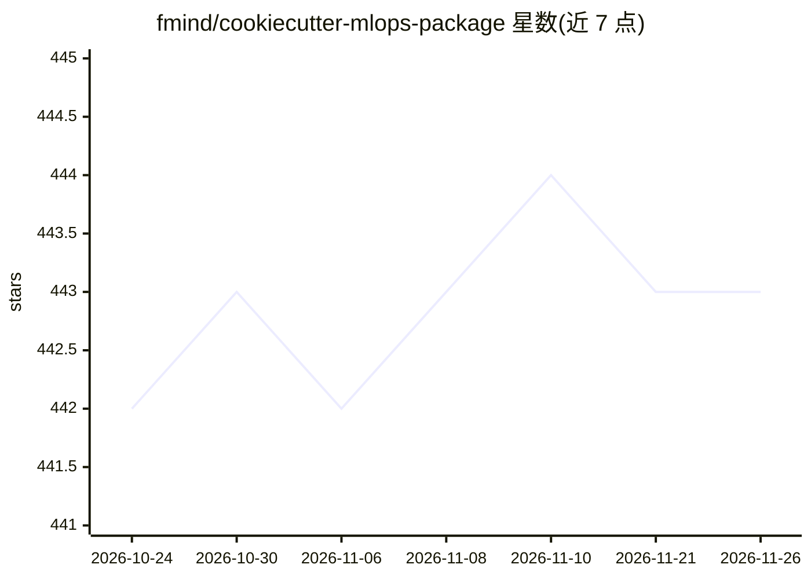

# fmind/cookiecutter-mlops-package

⭐ 443 · Python · MIT · 推送 2026-11-02 · [GitHub](https://github.com/fmind/cookiecutter-mlops-package) · [官网](https://mlops-coding-course.fmind.dev/) · 个人维护

**给 MLOps 开发者生成 Python 包与 Docker 工程骨架的 Cookiecutter 模板**

一个 Cookiecutter 项目模板，用于生成面向 MLOps 任务的 Python 包与 Docker 镜像工程。生成的项目内置 mise 统一任务门（install/format/check/test/build/all）、uv+Ruff+ty 单一工具链、pip-audit/gitleaks/Trivy/hadolint 等安全检查、pytest 烘焙测试、MLflow 3 跟踪与模型注册（SQLite 后端）、多阶段非 root Docker 镜像及 GitHub Actions CI/CD 工作流。生成的 CLI 仅为脚手架，不含数据加载与模型训练逻辑，需使用者自行实现。

## 筛选速览

| 维度 | 判定 | 备注 |
|---|---|---|
| AI 角色 | `ai-ecosystem` | LLM/agent 周边工具 |
| 许可风险 | `permissive` | MIT |
| 部署形态 | `self-host` | docker 或自建部署 |
| 模型依赖 | — | README 未给出锁定关系 |
| 硬件要求 | — | 无带数字的原话,不猜 |
| 安装摩擦 | `low` | 无编译、无系统依赖或容器化 |
| 成熟度 | — | 结构信号不足 |

## 能力要点

- uvx cookiecutter 一条命令生成项目，mise 定义统一任务门
- 安全检查内置于门：pip-audit、gitleaks、Trivy、hadolint、actionlint+zizmor
- MLflow 跟踪与模型注册使用 SQLite 后端，附 docker-compose 本地服务器
- GitHub Actions 提供 CI/CD 与每周全历史安全重扫

## 适用场景

- 为新的机器学习项目快速生成带测试与 CI/CD 的工程骨架
- 在 Kubernetes/Vertex AI/Databricks/Azure ML/SageMaker 等平台前统一打包基础
- 为团队建立一致的代码质量与安全检查流程

## 场景标签

`代码生成` · 领域:编码与开发

## 证据(README 行号)

> L7: The template provides a robust foundation for building, testing, packaging, and deploying Python packages and Docker
> L20: This template equips you with the essentials for creating, testing, and packaging your AI/ML code, providing a soli
> L110: The generated CLI accepts and logs configuration paths; it does not load data, train a model, or run the YAML jobs

## 星数曲线

2026-10-24 442 → 2026-11-26 443（+1）

---
*卡片 v1 · prompt 1.4 · 生成 2026-11-25 · 置信度 mid · 依据 README sha `e40a24542d90` · [字段定义](../../DATASET.md)*
