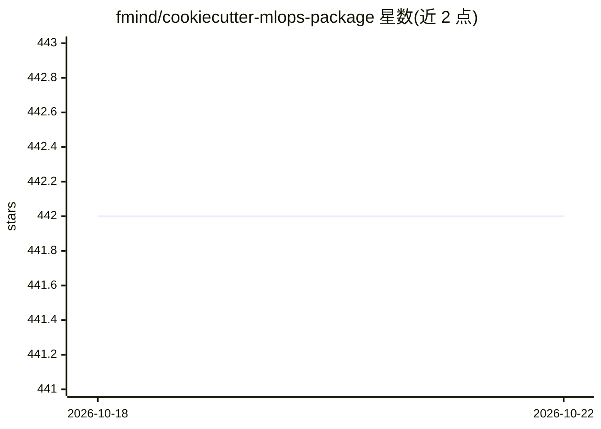

# fmind/cookiecutter-mlops-package

⭐ 442 · Python · MIT · 推送 2026-10-19 · [GitHub](https://github.com/fmind/cookiecutter-mlops-package) · [官网](https://mlops-coding-course.fmind.dev/) · 个人维护

**生成 MLOps Python 包与 Docker 镜像项目骨架的 Cookiecutter 模板**

面向 MLOps 开发者的 Cookiecutter 项目模板：通过 uvx cookiecutter 交互式生成包含 src/tests 结构、MLflow 配置（SQLite 跟踪存储与模型注册）、多阶段非 root Dockerfile、GitHub Actions CI/CD、mise 任务词汇表与安全检查（pip-audit/gitleaks/Trivy/hadolint）的 Python 包工程。生成的 CLI 仅为脚手架，不包含数据加载、模型训练或 YAML 任务执行逻辑，需参考 mlops-python-package 自行实现。模板自身 MIT 许可，生成项目默认 MIT。

## 筛选速览

| 维度 | 判定 | 备注 |
|---|---|---|
| AI 角色 | `ai-ecosystem` | LLM/agent 周边工具 |
| 许可风险 | `permissive` | MIT |
| 部署形态 | `self-host` | docker 或自建部署 |
| 模型依赖 | — | README 未给出锁定关系 |
| 硬件要求 | — | 无带数字的原话,不猜 |
| 安装摩擦 | `low` | 无编译、无系统依赖或容器化 |
| 成熟度 | — | 结构信号不足 |

## 能力要点

- mise 定义统一任务词汇（install/format/check/test/build/all）供 Git hooks、CI 与本地共用
- 生成多阶段非 root Docker 镜像与 GitHub Actions 发布流水线（GHCR 镜像、pdoc 文档）
- MLflow 跟踪与模型注册使用 SQLite 后端
- 测试通过临时目录烘焙真实项目并运行其完整 gate（含 Docker 构建与 MLflow Projects CLI 调用）

## 适用场景

- 快速初始化带 CI/CD 与安全检查的 MLOps Python 包工程
- 为 Kubernetes、Vertex AI、Databricks、Azure ML、SageMaker 等平台准备可部署的包与镜像
- 搭建含 MLflow 跟踪与模型注册的本地开发环境

## 场景标签

`代码生成` `MLOps` · 领域:编码与开发

## 证据(README 行号)

> L7: The template provides a robust foundation for building, testing, packaging, and deploying Python packages and Docker
> L18: This Cookiecutter is designed to be a common ground for diverse MLOps environments. Whether you're working with Kub

## 星数曲线

2026-10-18 442 → 2026-10-22 442（+0）

---
*卡片 v1 · prompt 1.4 · 生成 2026-10-21 · 置信度 mid · 依据 README sha `9ece8d4aef4f` · [字段定义](../../DATASET.md)*
