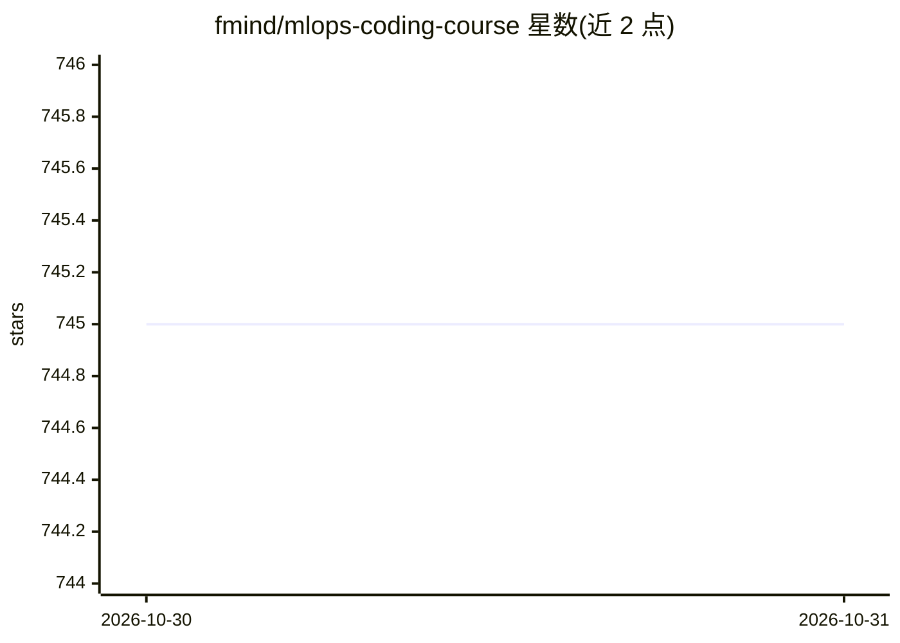

# fmind/mlops-coding-course

⭐ 745 · CC-BY-4.0 · 推送 2026-10-29 · [GitHub](https://github.com/fmind/mlops-coding-course) · [官网](https://mlops-coding-course.fmind.dev/) · 个人维护

**MLOps 编码课程：以 Python 项目实践 ML 工程开发全流程**

面向初学者与有经验专业人士的开源课程（CC-BY 4.0），按 Initializing、Prototyping、Productionizing、Validating、Refining、Sharing、Observability 七章组织，覆盖开发环境搭建、Jupyter 原型、Python 包化、测试与静态检查、CI/CD 与模型注册、文档与可观测性。工具链使用 uv、Ruff、ty、pytest、MLflow、mise、lefthook 等。通过 mise 驱动的任务安装依赖、构建并本地服务文档站点，含两个可在本地运行的实验（合成数据，无需数据集下载或云账号），并提供付费一对一辅导与团体培训。

## 筛选速览

| 维度 | 判定 | 备注 |
|---|---|---|
| AI 角色 | `ai-knowledge` | 知识聚合/清单类 |
| 许可风险 | `viral` | CC-BY-4.0 |
| 部署形态 | `None` |  |
| 模型依赖 | — | README 未给出锁定关系 |
| 硬件要求 | — | 无带数字的原话,不猜 |
| 安装摩擦 | `low` | 无编译、无系统依赖或容器化 |
| 成熟度 | — | 结构信号不足 |

## 能力要点

- 七章结构的 MLOps 编码课程，每章含可检查的 checkpoint
- mise/uv 驱动的安装、检查、测试、构建任务链
- 两个本地可运行实验，无需数据集下载或云账号
- 配套 AI 编码助手技能指令集（Agent Skills）仓库

## 适用场景

- 系统学习 ML 项目从原型到生产的工程实践
- 为团队引入 uv、pytest、MLflow 等 MLOps 工具链
- 通过本地运行的实验验证课程配置与模型选择代码

## 场景标签

`教程课程` `MLOps` · 领域:学习与行业

## 证据(README 行号)

> L5: This course is designed to dive deep into the intersection of software development and data science, focusing on the
> L26: ## Course Content

## 星数曲线

2026-10-30 745 → 2026-10-31 745（+0）

---
*卡片 v1 · prompt 1.4 · 生成 2026-10-29 · 置信度 high · 依据 README sha `c6a985779aff` · [字段定义](../../DATASET.md)*
