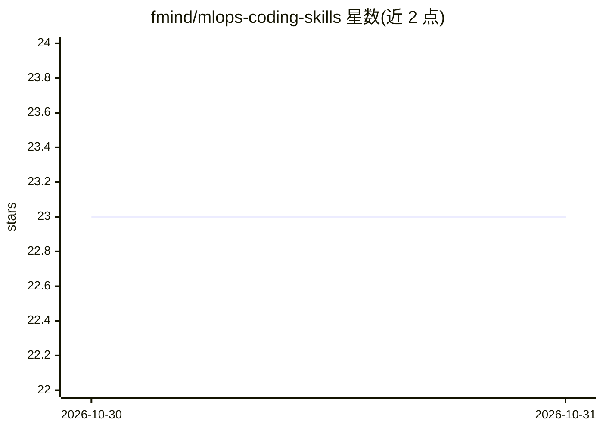

# fmind/mlops-coding-skills

⭐ 23 · MIT · 推送 2026-10-29 · [GitHub](https://github.com/fmind/mlops-coding-skills) · [官网](https://mlops-coding-course.fmind.dev/) · 个人维护

**配套 MLOps 课程的教学用 Agent Skills 集合（7 个技能）**

由 MLOps Coding Course 衍生的 Agent Skills 仓库：7 个技能分别对应课程一章，以 SKILL.md 格式（YAML frontmatter + Markdown 指令）提供从项目初始化、原型、生产化、验证、自动化（CI/CD、MLflow）到协作与可观测性的 MLOps 方法论指令。面向使用 AI 编码助手（Antigravity、Gemini CLI、GitHub Copilot、Claude Code）的开发者，通过克隆仓库并 symlink 到 .agents/skills/ 或各工具专属路径加载，也可用 gemini skills install 远程安装。

## 筛选速览

| 维度 | 判定 | 备注 |
|---|---|---|
| AI 角色 | `ai-knowledge` | 知识聚合/清单类 |
| 许可风险 | `permissive` | MIT |
| 部署形态 | `None` |  |
| 模型依赖 | — | README 未给出锁定关系 |
| 硬件要求 | — | 无带数字的原话,不猜 |
| 安装摩擦 | `low` | 无编译、无系统依赖或容器化 |
| 成熟度 | — | 结构信号不足 |

## 能力要点

- 7 个技能各对应课程一章，覆盖初始化到可观测性全流程
- 遵循开放 SKILL.md 标准，多工具从约定目录发现
- 提供 Antigravity/Gemini CLI/Claude Code/Copilot 各自的安装路径表
- 支持 gemini skills install 远程工作区安装

## 适用场景

- 让 AI 编码助手按课程方法论搭建 MLOps 项目结构
- 在原型与生产化阶段约束 AI 遵循可复现与防数据泄漏规范
- 为多个编码助手统一加载同一套 MLOps 技能

## 场景标签

`教程课程` `MLOps` · 领域:学习与行业

## 证据(README 行号)

> L5: This project contains a collection of **Agent Skills** designed to accompany the MLOps Coding Course. These skills a
> L9: Agent Skills are specialized context or instructions that you can load into your AI assistant. Each skill is a folde
> L13: Each skill derives from one chapter of the MLOps Coding Course:

## 星数曲线

2026-10-30 23 → 2026-10-31 23（+0）

---
*卡片 v1 · prompt 1.4 · 生成 2026-10-30 · 置信度 high · 依据 README sha `9769c41afc9a` · [字段定义](../../DATASET.md)*
