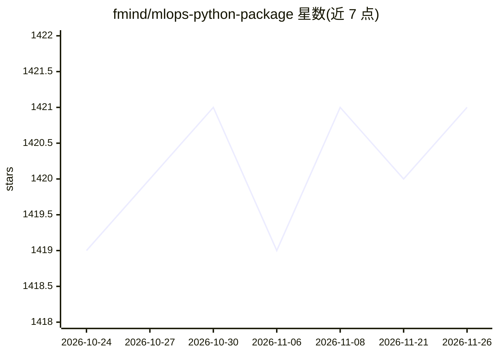

# fmind/mlops-python-package

⭐ 1,421 · Python · MIT · 推送 2026-11-14 · [GitHub](https://github.com/fmind/mlops-python-package) · [官网](https://fmind.github.io/mlops-python-package/) · 个人维护

**面向 MLOps 工程师的 Python 包模板与课程配套参考实现**

一个按生产形态组织的 Python MLOps 代码库，同时是 MLOps Coding Course 的参考实现。提供 TrainingJob/PipelineJob 等作业抽象，覆盖数据处理、训练、调优、评估、晋升别名与推理的完整流程；内置 UCI Bike Sharing 示例数据。工程化机制包括 mise 统一任务（install/format/check/test/build）、Lefthook git hooks、GitHub Actions CI/CD 与安全扫描、Pydantic 判别联合的配置解析、100% 覆盖率门槛。要求 Python>=3.14 与 uv，可用 Databricks 或 AWS 作为计算与模型注册平台。

## 筛选速览

| 维度 | 判定 | 备注 |
|---|---|---|
| AI 角色 | `ai-ecosystem` | LLM/agent 周边工具 |
| 许可风险 | `permissive` | MIT |
| 部署形态 | `self-host` | docker 或自建部署 |
| 模型依赖 | — | README 未给出锁定关系 |
| 硬件要求 | — | 无带数字的原话,不猜 |
| 安装摩擦 | `low` | 无编译、无系统依赖或容器化 |
| 成熟度 | — | 结构信号不足 |

## 能力要点

- mise 统一任务词表，git hooks 与 CI 共享同一命令
- TrainingJob/PipelineJob 流水线：调优、评估、Champion 别名晋升
- GitHub Workflows 覆盖 CI、发布门禁与每周安全扫描
- Pydantic Discriminated Unions 自动选择作业类型

## 适用场景

- 作为 MLOps 工具包或平台的起点模板
- 跟随 MLOps Coding Course 学习搭建可维护的代码库
- 参考 MLflow 训练/注册/评估/晋升的工程实践
- 用 Cookiecutter 从该模式生成新项目

## 场景标签

`MLOps` · 领域:训练与推理

## 证据(README 行号)

> L5: **This repository contains a Python code base with best practices designed to support your MLOps initiatives.**
> L9: You can use this package as part of your MLOps toolkit or platform (e.g., Model Registry, Experiment Tracking, Realt
> L14: - **MLOps Coding Course (Learning)**: Learn how to create, develop, and maintain a state-of-the-art MLOps code base

## 星数曲线

2026-10-24 1,419 → 2026-11-26 1,421（+2）

---
*卡片 v1 · prompt 1.4 · 生成 2026-11-23 · 置信度 low · 依据 README sha `27b09598cb62` · [字段定义](../../DATASET.md)*
