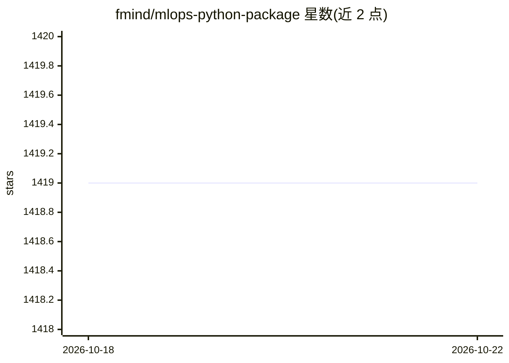

# fmind/mlops-python-package

⭐ 1,419 · Python · MIT · 推送 2026-10-19 · [GitHub](https://github.com/fmind/mlops-python-package) · [官网](https://fmind.github.io/mlops-python-package/) · 个人维护

**面向 MLOps 工程的 Python 参考代码库与最佳实践模板**

提供生产形态的 Python 代码库，作为 MLOps Coding Course 的参考实现：基于 MLflow 做实验跟踪与模型注册、scikit-learn 训练、Pydantic/Pandera 做数据与配置校验，用 uv 管理环境、mise 运行统一任务（install/format/check/test/build）。内置 UCI 自行车共享数据集的完整训练、调参、评估、晋升与推理流水线，附带三条 GitHub Actions 工作流（CI/CD/安全扫描）与 Docker Compose 支持。开发者可克隆仓库改造成自己的 MLOps 项目，或作为库安装使用。要求 Python>=3.14。

## 筛选速览

| 维度 | 判定 | 备注 |
|---|---|---|
| AI 角色 | `ai-ecosystem` | LLM/agent 周边工具 |
| 许可风险 | `permissive` | MIT |
| 部署形态 | `self-host` | docker 或自建部署 |
| 模型依赖 | — | README 未给出锁定关系 |
| 硬件要求 | — | 无带数字的原话,不猜 |
| 安装摩擦 | `low` | 无编译、无系统依赖或容器化 |
| 成熟度 | — | 结构信号不足 |

## 能力要点

- MLflow 实验跟踪、模型注册与 Champion 别名晋升机制
- Pydantic Discriminated Unions 按配置自动选择训练/调参/评估/推理任务
- mise 统一任务词汇表，供 git hooks 与 CI 共用（mise run all）
- 三条 GitHub Actions 工作流：CI、带 Docker 镜像扫描的发布、每周安全扫描（gitleaks/trivy）

## 适用场景

- 作为 MLOps 项目的起始模板并按需改造代码
- 学习包含调参、评估、晋升门槛的完整模型流水线实现
- 复用其 CI/CD 与安全扫描工作流自动化包管理任务

## 场景标签

`MLOps` `教程课程` · 领域:学习与行业

## 证据(README 行号)

> L5: **This repository contains a Python code base with best practices designed to support your MLOps initiatives.**
> L9: You can use this package as part of your MLOps toolkit or platform (e.g., Model Registry, Experiment Tracking, Realt
> L63: The `PipelineJob` in `confs/pipeline.yaml` passes the full tuned model configuration and selected parameters into t

## 星数曲线

2026-10-18 1,419 → 2026-10-22 1,419（+0）

---
*卡片 v1 · prompt 1.4 · 生成 2026-10-21 · 置信度 mid · 依据 README sha `e4f1a681d6ea` · [字段定义](../../DATASET.md)*
