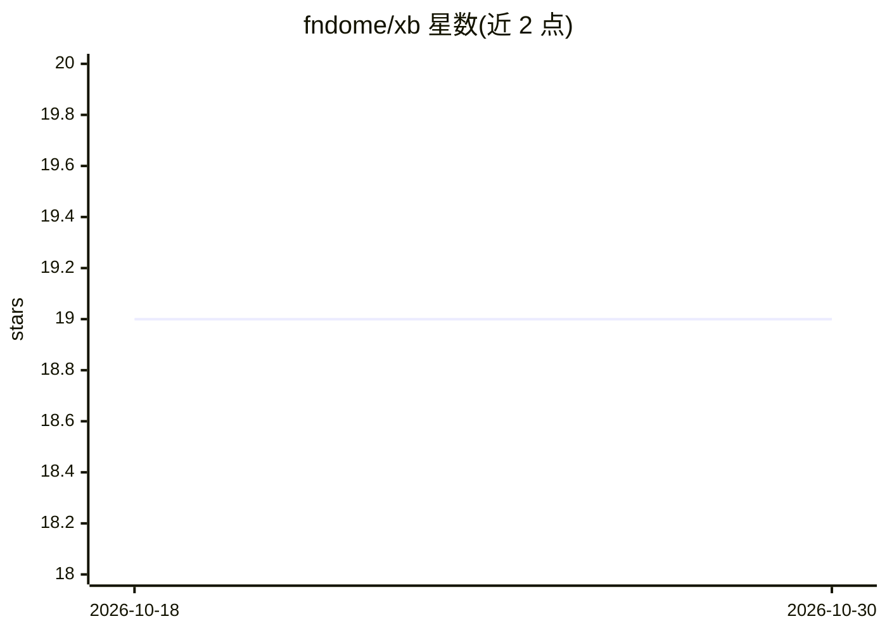

# fndome/xb

⭐ 19 · Go · Apache-2.0 · 推送 2026-08-23 · [GitHub](https://github.com/fndome/xb) · [官网](https://fndome.github.io/xb/) · 个人维护 · 中文 README

**Go 语言的 SQL/JSON 查询构建器，覆盖关系库与 Qdrant 向量库**

面向 Go 开发者的流式 API 查询构建库：一套链式 DSL 同时生成 SQL（适配 database/sql、sqlx、gorm 及任意原生驱动）和 JSON（面向 Qdrant 的 Recommend/Discover/Scroll 等流程）。支持 CTE+UNION 管道、自动过滤 nil/零值条件的 DSL、JOIN 自动优化、拦截器与 Meta 元数据注入，并可通过实现 Custom 接口扩展 Oracle、Milvus 等方言或自定义向量库后端。文档分中英双语目录，代码由 AI 协作编写并经人工审查。

## 筛选速览

| 维度 | 判定 | 备注 |
|---|---|---|
| AI 角色 | `ai-ecosystem` | LLM/agent 周边工具 |
| 许可风险 | `permissive` | Apache-2.0 |
| 部署形态 | `None` |  |
| 模型依赖 | — | README 未给出锁定关系 |
| 硬件要求 | — | 无带数字的原话,不猜 |
| 安装摩擦 | `low` | 无编译、无系统依赖或容器化 |
| 成熟度 | — | 结构信号不足 |

## 能力要点

- 一套流式 API 同时生成 SQL 与 Qdrant 查询 JSON
- 条件 DSL 自动过滤 nil/零值，支持原始表达式 X() 与子查询复用
- 实现 Custom 接口即可扩展新方言或向量库后端，无需分叉核心
- BeforeBuild/AfterBuild 拦截器与 Meta(func) 注入 TraceID/UserID 等元数据

## 适用场景

- 在 Go 服务中统一构建关系库与向量库查询
- 为 RAG 应用编写 Qdrant 混合检索（SQL 表 + 向量相似度）查询
- 通过方言机制切换不同数据库的引用与占位符风格

## 场景标签

 · 领域:数据库/开发库

## 证据(README 行号)

> L9: `xb` is an AI-first SQL/JSON builder for relational + vector databases. One fluent API builds:
> L12: - JSON for Qdrant (Recommend / Discover / Scroll) and other vector stores

## 星数曲线

2026-10-18 19 → 2026-10-30 19（+0）

---
*卡片 v1 · prompt 1.4 · 生成 2026-10-28 · 置信度 high · 依据 README sha `9a00604713c4` · [字段定义](../../DATASET.md)*
