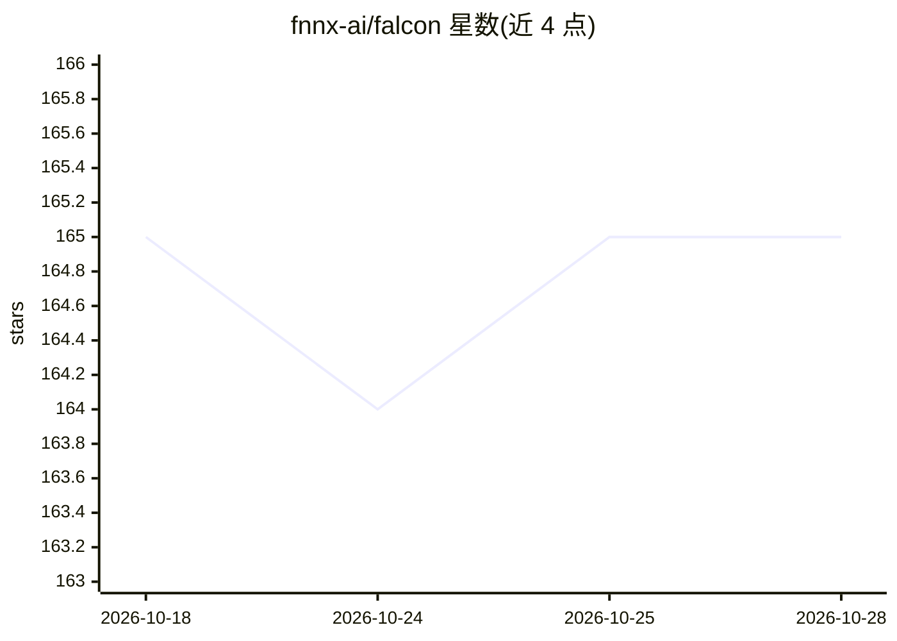

# fnnx-ai/falcon

⭐ 165 · Python · MIT · 推送 2026-08-18 · [GitHub](https://github.com/fnnx-ai/falcon) · [官网](https://fnnx.ai/) · 组织维护

**轻量级 Python AutoML 库：一行代码训练生产级模型**

Falcon 是 Python AutoML 库，面向需要快速构建机器学习管线的开发者：指定任务类型与训练数据路径（如 CSV）即可在一行代码内完成训练，支持表格分类/回归等任务并提供演示数据集。内置多组预设配置，可通过参数切换内部组件。核心机制是对 FNNX/ONNX 模型的原生支持，可将复杂管线导出为单一生产就绪文件，部署时不依赖训练环境。以 falcon-ml 包从 PyPI 安装，可选 extras 增加 FNNX 运行时、梯度提升候选与超参搜索。

## 筛选速览

| 维度 | 判定 | 备注 |
|---|---|---|
| AI 角色 | `ai-native` | 本体是模型或模型工具 |
| 许可风险 | `permissive` | MIT |
| 部署形态 | `library` | 以包/库形式分发 |
| 模型依赖 | — | README 未给出锁定关系 |
| 硬件要求 | — | 无带数字的原话,不猜 |
| 安装摩擦 | `low` | 无编译、无系统依赖或容器化 |
| 成熟度 | — | 结构信号不足 |

## 能力要点

- 一行代码完成机器学习管线训练
- 对 FNNX/ONNX 模型的原生支持，管线可导出为单一文件
- 预设配置支持内部组件替换
- 可选 extras 提供 FNNX 运行时、GBDT 候选与超参搜索

## 适用场景

- 用表格数据快速训练分类或回归模型
- 将训练好的管线导出为无环境依赖的部署文件
- 通过预设配置快速尝试不同管线组件

## 场景标签

`MLOps` · 领域:训练与推理

## 证据(README 行号)

> L4: Falcon is a lightweight python library that allows to train production-ready machine learning models in a single lin
> L21: AutoML(task = 'tabular_classification', train_data = '/path/to/titanic.csv')

## 星数曲线

2026-10-18 165 → 2026-10-28 165（+0）

---
*卡片 v1 · prompt 1.4 · 生成 2026-10-22 · 置信度 high · 依据 README sha `a99f6ea8cb30` · [字段定义](../../DATASET.md)*
