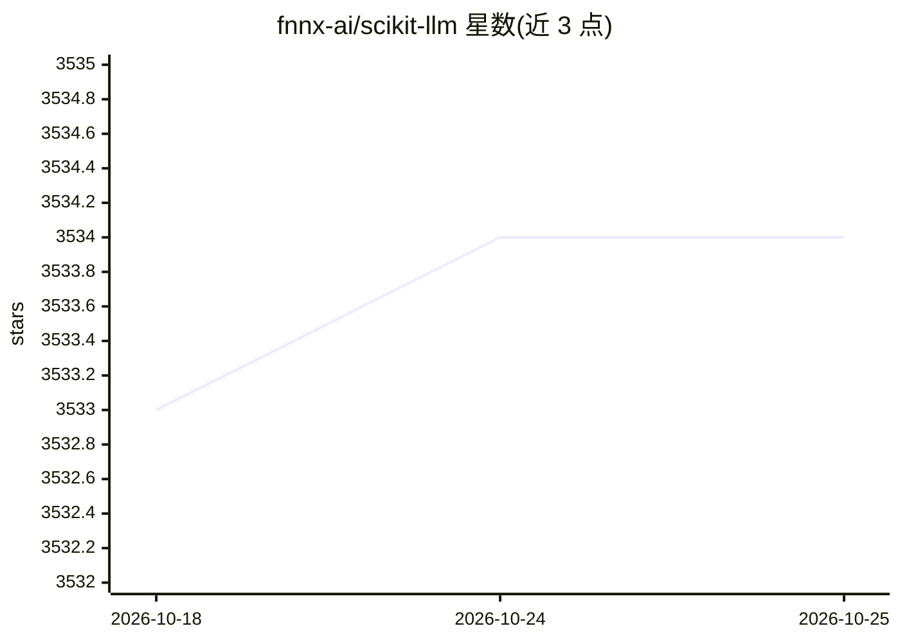

# fnnx-ai/scikit-llm

⭐ 3,534 · Python · MIT · 推送 2026-10-10 · [GitHub](https://github.com/fnnx-ai/scikit-llm) · [官网](https://beastbyte.ai/) · 组织维护

**将 LLM 集成到 scikit-learn 的 Python 库**

Scikit-LLM 是一个把 ChatGPT 等语言模型接入 scikit-learn 流水线的 Python 库，用于文本分析任务，README 示例展示使用 GPT 进行零样本文本分类。通过 pip 安装，配置 API 密钥后即可在 sklearn 风格代码中调用模型。作者为 Iryna Kondrashchenko 与 Oleh Kostromin（2023 年），提供文档与 BibTeX 引用。README 未展示完整 API 与支持的全部模型清单。

## 筛选速览

| 维度 | 判定 | 备注 |
|---|---|---|
| AI 角色 | `ai-ecosystem` | LLM/agent 周边工具 |
| 许可风险 | `permissive` | MIT |
| 部署形态 | `library` | 以包/库形式分发 |
| 模型依赖 | — | README 未给出锁定关系 |
| 硬件要求 | — | 无带数字的原话,不猜 |
| 安装摩擦 | `low` | 无编译、无系统依赖或容器化 |
| 成熟度 | — | 结构信号不足 |

## 能力要点

- 将语言模型接入 scikit-learn 流水线
- 示例演示 GPT 零样本文本分类
- pip 安装，附快速开始与文档入口

## 适用场景

- 在 scikit-learn 工作流中做零样本文本分类
- 让熟悉 sklearn 的开发者使用 LLM 处理文本任务

## 场景标签

 · 领域:机器学习/NLP 工具库

## 证据(README 行号)

> L5: Seamlessly integrate powerful language models like ChatGPT into scikit-learn for enhanced text analysis tasks.
> L35: Quick start example of zero-shot text classification using GPT:

## 星数曲线

2026-10-18 3,533 → 2026-10-25 3,534（+1）

---
*卡片 v1 · prompt 1.4 · 生成 2026-10-21 · 置信度 mid · 依据 README sha `1951beb91c0d` · [字段定义](../../DATASET.md)*
