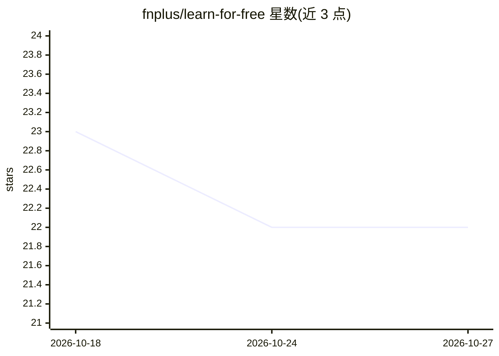

# fnplus/learn-for-free

⭐ 22 · MIT · 推送 2026-01-20 · [GitHub](https://github.com/fnplus/learn-for-free) · 组织维护

**社区维护的免费学习资源清单：覆盖编程、ML、Web 等领域**

由 fn+geeks 社区贡献的学习资源聚合清单，按主题组织免费教程与课程链接：基础计算机科学（C++/Python）、Git、设计模式、3D 图形、AR、Android、云服务、Django、机器学习与深度学习课程（Google、MIT、FastAI、Coursera 等）、数据科学、Web 开发（HTML/CSS/JS/Node.js）与安全。条目多为 YouTube 教程、官方课程与开源书籍的链接，部分附简介说明。仅作内容索引，不含可安装或可运行的软件。

## 筛选速览

| 维度 | 判定 | 备注 |
|---|---|---|
| AI 角色 | `ai-knowledge` | 知识聚合/清单类 |
| 许可风险 | `permissive` | MIT |
| 部署形态 | `None` |  |
| 模型依赖 | — | README 未给出锁定关系 |
| 硬件要求 | — | 无带数字的原话,不猜 |
| 安装摩擦 | `low` | 无编译、无系统依赖或容器化 |
| 成熟度 | — | 结构信号不足 |

## 能力要点

- 按 18 个技术主题组织的免费学习资源索引
- 机器学习/深度学习课程覆盖 Google、MIT、FastAI、Coursera 等来源
- 条目附社区撰写的课程简介与适用人群说明
- 面向 Hacktoberfest 开放社区贡献

## 适用场景

- 初学者按主题查找免费的编程与 CS 入门教程
- 查找机器学习与深度学习的免费系统课程
- 收集 Web 开发与安全方向的免费学习资料

## 场景标签

`精选清单` · 领域:学习与行业

## 证据(README 行号)

> L1: # Resource-list-for-learners
> L79: ## Machine Learning

## 星数曲线

2026-10-18 23 → 2026-10-27 22（-1）

---
*卡片 v1 · prompt 1.4 · 生成 2026-10-27 · 置信度 high · 依据 README sha `8fcbac50d870` · [字段定义](../../DATASET.md)*
