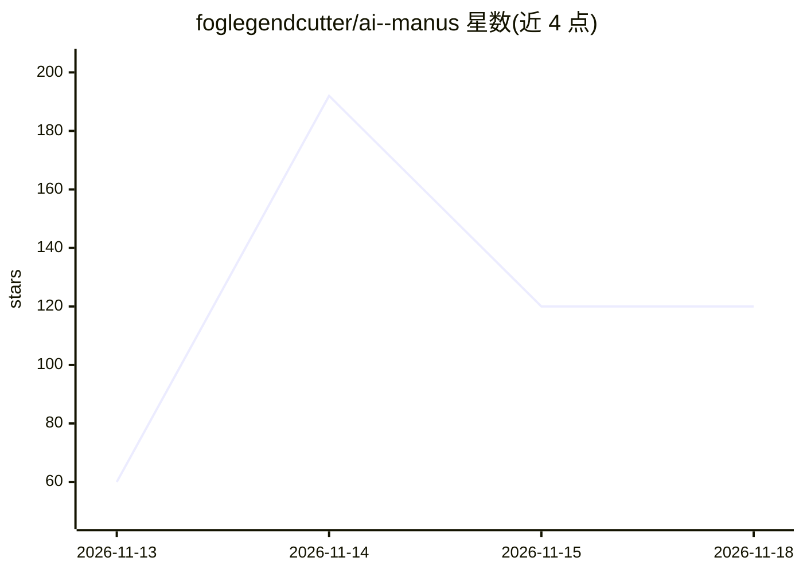

# foglegendcutter/ai--manus

⭐ 120 · Apache-2.0 · 推送 2026-11-15 · [GitHub](https://github.com/foglegendcutter/ai--manus) · 个人维护

**面向日常小任务的自主 AI Agent：代写代码并控制浏览器**

README 宣称的自主 AI Agent：按用户指令编写并执行脚本、控制浏览器完成网页导航、表单填写与信息收集，可执行多步骤任务，定位为家庭、学习与轻量办公场景的个人助手而非企业平台。页面内容以功能介绍与 SEO 关键词为主，未提供安装命令、依赖清单、模型接入方式或源码使用说明，仅给出硬件兼容表与上手步骤的文字描述。技术实现与许可信息在 README 内不可验证。

## 筛选速览

| 维度 | 判定 | 备注 |
|---|---|---|
| AI 角色 | `ai-native` | 本体是模型或模型工具 |
| 许可风险 | `permissive` | Apache-2.0 |
| 部署形态 | `None` |  |
| 模型依赖 | — | README 未给出锁定关系 |
| 硬件要求 | — | 无带数字的原话,不猜 |
| 安装摩擦 | `low` | 无编译、无系统依赖或容器化 |
| 成熟度 | — | 结构信号不足 |

## 能力要点

- 宣称可自主执行代码与控制浏览器
- 支持跨代码与浏览器的多步骤任务
- 面向家庭/学习/轻量办公的小规模场景

## 适用场景

- 让 agent 代为查网页、填表单、收集资料
- 自动执行小型脚本与文件整理等重复任务
- 学习与轻办公中委派琐碎多步操作

## 场景标签

`AI 助手` `编码 Agent` `浏览器自动化` · 领域:效率与自动化

## 证据(README 行号)

> L10: - **Autonomous Code Execution:** Manus AI agent runs code on its own to complete tasks, so you can focus on decisio
> L18: Manus is an autonomous AI agent designed to run code and control a browser on your behalf. Instead of acting like a

## 星数曲线

2026-11-13 60 → 2026-11-18 120（+60）

---
*卡片 v1 · prompt 1.4 · 生成 2026-11-17 · 置信度 mid · 依据 README sha `0f78ee3a5dd2` · [字段定义](../../DATASET.md)*
