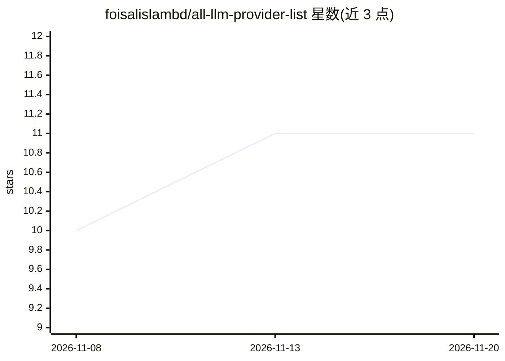

# foisalislambd/all-llm-provider-list

⭐ 11 · Python · 推送 2026-11-17 · [GitHub](https://github.com/foisalislambd/all-llm-provider-list) · 个人维护

**面向开发者的 494 个 LLM 提供商目录与本地查询工具**

收录 494 个 AI/LLM 提供商、4,491 个模型 ID 的目录仓库，按前沿实验室、推理平台、网关路由、聚合器、本地自托管等 13 类组织，记录 API Base URL、模型名与环境变量。附 Python 查询脚本 llm_lookup.py（按提供商/类别/模型搜索，无额外依赖），以及同作者的本地路由工具 WowRouter：将多个提供商 key 汇聚为一个 OpenAI 兼容路由 key，供编码 agent 接入。README 提醒以官方文档核对端点。

## 筛选速览

| 维度 | 判定 | 备注 |
|---|---|---|
| AI 角色 | `ai-knowledge` | 知识聚合/清单类 |
| 许可风险 | `none` | — |
| 部署形态 | `self-host` | docker 或自建部署 |
| 模型依赖 | — | README 未给出锁定关系 |
| 硬件要求 | — | 无带数字的原话,不猜 |
| 安装摩擦 | `low` | 无编译、无系统依赖或容器化 |
| 成熟度 | — | 结构信号不足 |

## 能力要点

- 494 个提供商、4,491 个模型 ID，含 API URL、环境变量与模型名
- 13 个分类：前沿实验室 73、网关路由 134、本地自托管 27 等
- llm_lookup.py 命令行查询工具，无需额外依赖
- WowRouter 本地路由（127.0.0.1:8787）与 fallback 链

## 适用场景

- 为项目挑选合适的模型 API 并快速查到 base_url 与环境变量名
- 按类别浏览网关、聚合器或本地自托管选项
- 用 WowRouter 把多个提供商 key 统一为单一路由 key 供编码 agent 使用

## 场景标签

`精选清单` `模型网关` · 领域:Agent 开发

## 证据(README 行号)

> L3: **494 providers** · 4,491 model IDs · API URLs, env vars, and model names in one place.
> L67: ## Categories

## 星数曲线

2026-11-08 10 → 2026-11-20 11（+1）

---
*卡片 v1 · prompt 1.4 · 生成 2026-11-18 · 置信度 high · 依据 README sha `310b603e1a23` · [字段定义](../../DATASET.md)*
