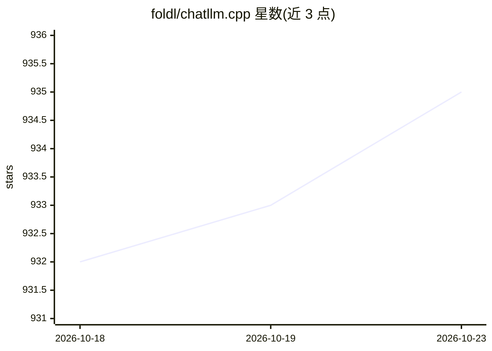

# foldl/chatllm.cpp

⭐ 935 · C++ · MIT · 推送 2026-10-21 · [GitHub](https://github.com/foldl/chatllm.cpp) · 个人维护 · 中文 README

**纯 C++ 的本地 LLM 推理与实时对话框架（CPU/GPU）**

基于 ggml 的纯 C++ 实现，在本地 CPU/GPU 上运行 1B 至 300B 以上多种模型的推理，支持多模态对话、RAG、LoRA、工具调用、语音（Qwen2-Audio/Orpheus-TTS）、视觉与图像生成等能力。提供 int4/int8 量化、KV cache 优化、流式生成、长对话上下文扩展、分布式推理与 GPU 加速，并有 Python/JavaScript/C/Nim 绑定与 OpenAI API。从源码克隆后用 CMake 构建，convert.py 将 HF 格式模型转为自有的 GGML 格式（与 llama.cpp 的 GGUF 不兼容）。作者声明为学习性质的爱好的项目，不接收功能 PR。

## 筛选速览

| 维度 | 判定 | 备注 |
|---|---|---|
| AI 角色 | `ai-ecosystem` | LLM/agent 周边工具 |
| 许可风险 | `permissive` | MIT |
| 部署形态 | `library` | 以包/库形式分发 |
| 模型依赖 | — | README 未给出锁定关系 |
| 硬件要求 | — | 无带数字的原话,不猜 |
| 安装摩擦 | `medium` | 含编译或系统依赖之一 |
| 成熟度 | `idea` | |

## 能力要点

- 支持 1B~300B+ 多模型的 CPU/GPU 本地推理
- int4/int8 量化、KV cache 优化、分布式推理与 GPU 加速
- RAG、LoRA、工具调用、多模态（视觉/语音/TTS）与 OpenAI API
- Python/JavaScript/C/Nim 绑定与按 tensor 定制量化

## 适用场景

- 在本机离线与多种开源大模型对话
- 对模型做细粒度量化并本地部署
- 通过绑定语言在自己的程序中嵌入推理能力

## 场景标签

`推理引擎` `模型量化` `聊天机器人` · 领域:对话与助手

## 证据(README 行号)

> L9: Inference of a bunch of models from less than 1B to more than 300B, for real-time multimodal chat with RAG on your c
> L62: * [x] Accelerated memory-efficient CPU/GPU inference with int4/int8 quantization, optimized KV cache and parallel c

## 星数曲线

2026-10-18 932 → 2026-10-23 935（+3）

---
*卡片 v1 · prompt 1.4 · 生成 2026-10-21 · 置信度 mid · 依据 README sha `ec21da1d8ced` · [字段定义](../../DATASET.md)*
