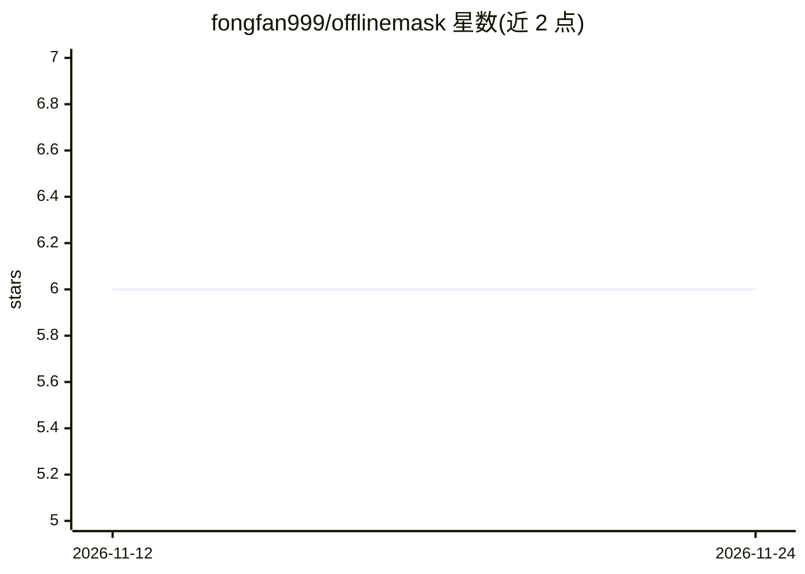

# fongfan999/offlinemask

⭐ — · [GitHub]() · 个人维护

**粘贴给外部 AI 前在本地脱敏敏感数据的桌面应用**

面向越南语用户的桌面应用：粘贴文本或打开文件后，在本机将姓名、账号、电话等隐私值替换为一致的别名，用户复制到外部 AI 工具，再将回复粘回恢复原值。无服务器、无遥测、无自动更新检查，首次启动即可离线使用（内置规则检测），可选 712 MB 识别包通过 ONNX Runtime 本地运行。支持 XLSX/DOCX/CSV/PDF 等文件与文件夹，可设密码将历史加密存于本地保险库；Linux 构建仍在测试，检测存在已记录的漏检与过度遮蔽，需人工复核。

## 筛选速览

| 维度 | 判定 | 备注 |
|---|---|---|
| AI 角色 | `ai-native` | 本体是模型或模型工具 |
| 许可风险 | `none` | — |
| 部署形态 | `library` | 以包/库形式分发 |
| 模型依赖 | — | README 未给出锁定关系 |
| 硬件要求 | — | 无带数字的原话,不猜 |
| 安装摩擦 | `low` | 无编译、无系统依赖或容器化 |
| 成熟度 | `idea` | |

## 能力要点

- 规则+可选 ONNX 模型包的本地 PII 检测，全程离线
- 别名会话一致性保证 AI 回复可精确还原
- 表格/文档遮蔽保留格式，扫描件与图片在本机读取遮蔽
- 可选 Argon2id+XChaCha20-Poly1305 加密本地历史保险库

## 适用场景

- 把含姓名、账号、电话的文本粘贴给 ChatGPT/Claude/Gemini 前先脱敏
- 遮蔽并还原与外部 AI 往返的表格和文档文件
- 在任意应用中选中文字就地遮蔽（Ẩn nhanh）后发给 AI

## 场景标签

 · 领域:隐私工具/桌面应用

## 证据(README 行号)

> L11: OfflineMask is a free desktop app for preparing sensitive text before pasting it into an external AI tool. You past
> L20: - **An optional recognition pack** adds contextual categories: names, addresses, organizations, birth dates, card a

## 星数曲线

2026-11-12 6 → 2026-11-24 6（+0）

---
*卡片 v1 · prompt 1.4 · 生成 2026-11-20 · 置信度 high · 依据 README sha `f4b0d09cd8eb` · [字段定义](../../DATASET.md)*
