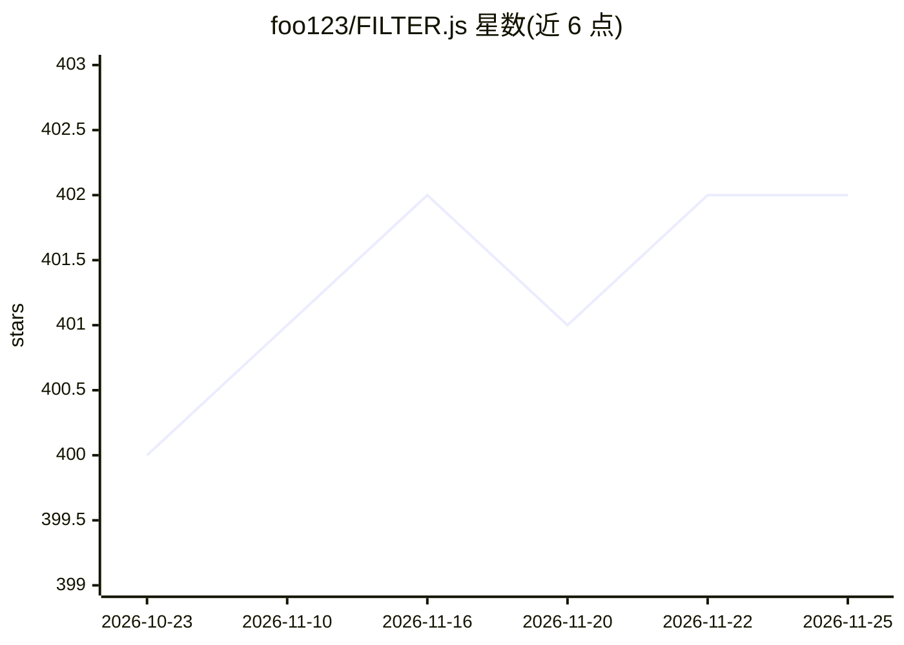

# foo123/FILTER.js

⭐ 402 · JavaScript · 推送 2026-11-19 · [GitHub](https://github.com/foo123/FILTER.js) · [官网](https://foo123.github.io/examples/filter/) · 个人维护

**浏览器/Node.js 纯 JS 图像视频处理与计算机视觉库**

纯 JavaScript 的图像/视频处理、滤波与计算机视觉库，浏览器端基于 Canvas、Web Workers、WebAssembly 与 WebGL 实现，Node.js 端通过 CanvasLite、node-canvas 等替代方案运行。定义 Image 代理类、Color 工具类与 14 种通用 Filter 类型及插件，内置 grayscale、threshold、gaussBlur、laplace 等实现滤波器。支持 CPU 与 GPU 并行处理并可在两者间透明混用，支持自定义按需构建，各滤波器/插件可混搭组合。

## 筛选速览

| 维度 | 判定 | 备注 |
|---|---|---|
| AI 角色 | `ai-native` | 本体是模型或模型工具 |
| 许可风险 | `none` | — |
| 部署形态 | `None` |  |
| 模型依赖 | — | README 未给出锁定关系 |
| 硬件要求 | — | 无带数字的原话,不猜 |
| 安装摩擦 | `low` | 无编译、无系统依赖或容器化 |
| 成熟度 | — | 结构信号不足 |

## 能力要点

- 14 种通用 Filter 类型加插件与扩展滤波器
- CPU（Web Workers）与 GPU/WebGL（GLSL）并行处理，透明混用
- 支持 WebAssembly 与汇编编码滤波器
- 各滤波器/插件独立可混搭，支持自定义构建

## 适用场景

- 在浏览器中对图像/视频做实时滤波处理
- 在 Node.js 环境处理图像（CanvasLite/node-canvas 等）
- 做边缘检测、形态学、特征检测等计算机视觉任务
- 按需挑选滤波器构建自定义版本库

## 场景标签

`图像视频处理` · 领域:感知与多模态

## 证据(README 行号)

> L3: **A pure JavaScript Library for Image/Video Processing, Filtering and Computer Vision**
> L5: This is a library for processing images/video in pure JavaScript using HTML5 features like `Canvas`, **Web Workers, 
> L38: The framework defines an `Image` class, which represents a proxy for an Image, a number of utilities like `Color` c

## 星数曲线

2026-10-23 400 → 2026-11-25 402（+2）

---
*卡片 v1 · prompt 1.4 · 生成 2026-11-25 · 置信度 high · 依据 README sha `c93338ab9fbb` · [字段定义](../../DATASET.md)*
