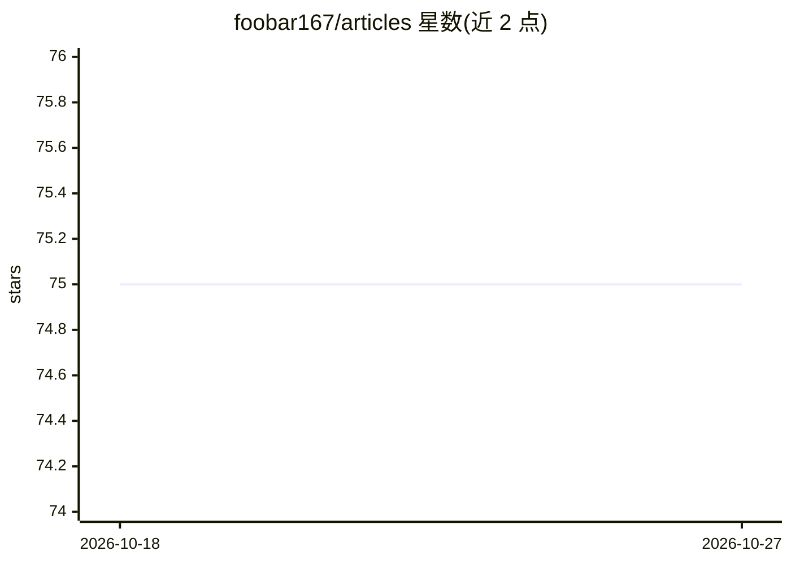

# foobar167/articles

⭐ 75 · Jupyter Notebook · MIT · 推送 2026-10-01 · [GitHub](https://github.com/foobar167/articles) · 个人维护

**个人技术文章与操作指南合集（机器学习、Ubuntu 等）**

个人维护的文章与操作说明仓库，内容包含机器学习文章及代码示例、日常任务中产生的 Ubuntu 操作指南，主题标签还涉及 Anaconda 环境、Python 虚拟环境、Technology SG 等。以 Markdown 文章与配套代码形式提供，供读者查阅与参考，无独立软件需安装运行。

## 筛选速览

| 维度 | 判定 | 备注 |
|---|---|---|
| AI 角色 | `ai-knowledge` | 知识聚合/清单类 |
| 许可风险 | `permissive` | MIT |
| 部署形态 | `None` |  |
| 模型依赖 | — | README 未给出锁定关系 |
| 硬件要求 | — | 无带数字的原话,不猜 |
| 安装摩擦 | `low` | 无编译、无系统依赖或容器化 |
| 成熟度 | — | 结构信号不足 |

## 能力要点

- 机器学习文章与配套代码示例
- 来自日常任务的 Ubuntu 操作指南
- 涵盖 Anaconda/Python 虚拟环境配置说明

## 适用场景

- 查找机器学习入门文章和可运行代码示例
- 参考 Ubuntu 日常任务的解决步骤
- 了解 Anaconda 与 Python 虚拟环境配置方法

## 场景标签

`教程课程` · 领域:学习与行业

## 证据(README 行号)

> L1: ### A bunch of my unique articles and instructions.
> L2:  - Machine Learning articles and code examples

## 星数曲线

2026-10-18 75 → 2026-10-27 75（+0）

---
*卡片 v1 · prompt 1.4 · 生成 2026-10-24 · 置信度 mid · 依据 README sha `021aae940226` · [字段定义](../../DATASET.md)*
