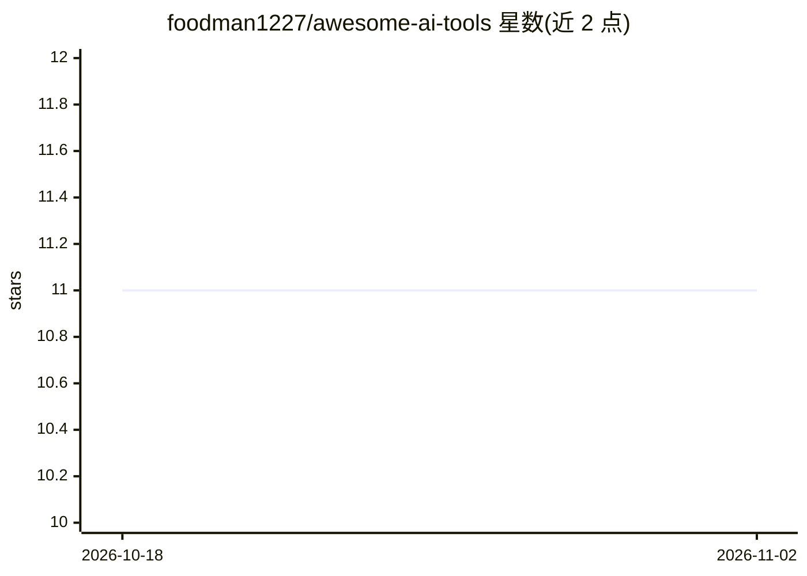

# foodman1227/awesome-ai-tools

⭐ 11 · 推送 2026-10-13 · [GitHub](https://github.com/foodman1227/awesome-ai-tools) · [官网](https://foodman1227.github.io) · 个人维护

**面向创作者与开发者的 AI 工具合集安装包**

自称是一个精选 AI 工具合集，覆盖内容生成、视频自动化、API 集成、网站搭建与 AI 语音集成五类功能，通过 GitHub Releases 页下载安装包的方式分发，而非以代码仓库形式提供源码安装步骤。README 声明支持 Windows 10+/macOS 10.14+/Linux，要求至少 4 GB 内存与 1 GB 磁盘空间。文档、社区与许可信息指向仓库内其他位置，README 未给出具体功能实现细节或第三方工具明细。

## 筛选速览

| 维度 | 判定 | 备注 |
|---|---|---|
| AI 角色 | `ai-knowledge` | 知识聚合/清单类 |
| 许可风险 | `none` | — |
| 部署形态 | `desktop` | 安装包/桌面程序 |
| 模型依赖 | — | README 未给出锁定关系 |
| 硬件要求 | — | 无带数字的原话,不猜 |
| 安装摩擦 | `low` | 无编译、无系统依赖或容器化 |
| 成熟度 | — | 结构信号不足 |

## 能力要点

- 声明覆盖内容生成、视频自动化、API 集成、网站创建、AI 语音五类功能
- 通过 Releases 页面分发可下载安装包
- 声明支持 Windows/macOS/Linux 三平台

## 适用场景

- 希望通过单一安装包获得多种 AI 自动化功能
- 进行内容与视频的自动化生成
- 在项目中集成 API 与 AI 语音功能

## 场景标签

`精选清单` · 领域:学习与行业

## 证据(README 行号)

> L7: awesome-ai-tools is a curated collection of AI tools that make it easy to build, automate, and monetize projects. Wh

## 星数曲线

2026-10-18 11 → 2026-11-02 11（+0）

---
*卡片 v1 · prompt 1.4 · 生成 2026-11-02 · 置信度 low · 依据 README sha `1afaf70d4e25` · [字段定义](../../DATASET.md)*
