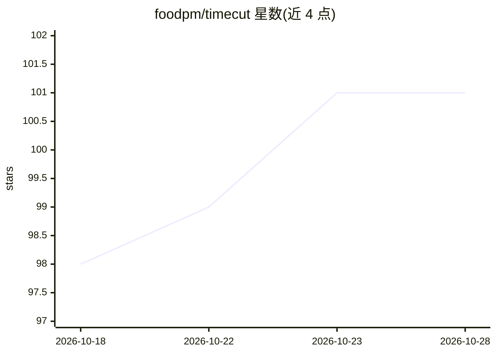

# foodpm/timecut

⭐ 101 · Python · MIT · 推送 2026-10-12 · [GitHub](https://github.com/foodpm/timecut) · 个人维护 · 中文 README

**NAS Docker 上的监控录像系统，自动剪辑每日精华并生成日记**

跑在 NAS 上的监控摄像头录像管理系统：go2rtc 接入 RTSP/小米流供浏览器实时查看，FFmpeg 分段循环录像并按天保留清理。每日自动分析录像生成精华视频，支持运动检测与多模态大模型识别两种模式，内置 YOLO11n 做人物过滤、时段去重限制同一小时最多保留 2 段；可选调用大模型（OpenAI 兼容 API，默认 dashscope/qwen-vl-plus）识别有价值画面并生成第一人称日记。提供 Web 管理面板，Docker Compose 一键部署，另支持离线镜像包导入。

## 筛选速览

| 维度 | 判定 | 备注 |
|---|---|---|
| AI 角色 | `ai-enhanced` | 去掉 AI 部分产品仍成立 |
| 许可风险 | `permissive` | MIT |
| 部署形态 | `self-host` | docker 或自建部署 |
| 模型依赖 | — | README 未给出锁定关系 |
| 硬件要求 | — | 无带数字的原话,不猜 |
| 安装摩擦 | `low` | 无编译、无系统依赖或容器化 |
| 成熟度 | — | 结构信号不足 |

## 能力要点

- go2rtc 实时画面（MSE/WebRTC）+ FFmpeg 循环录像按天保留
- 内置 YOLO11n 人物过滤，当天无人自动回退运动模式
- 大模型模式抽帧调用多模态模型判断人员/车辆/包裹等事件
- 每日大模型日记生成，时段去重让精华分散覆盖全天

## 适用场景

- 在 NAS 上长期录制和管理监控摄像头录像
- 自动回顾一天中有人或有事件发生的画面
- 远程通过浏览器查看摄像头实时画面和回放

## 场景标签

`目标检测` `图像视频处理` · 领域:感知与多模态

## 证据(README 行号)

> L10: 一个跑在 NAS Docker 上的监控摄像头录像管理系统。接入摄像头实时流，支持**循环录像**、**按天保留**、**每日精华视频自动剪辑**（可选**大模型识别**有价值画面），并提供浏览器 Web 管理界面。
> L16: - **🤖 大模型精华筛选**：每日自动分析录像，支持「系统自动（运动检测）」与「大模型识别」两种模式——大模型模式对运动片段抽帧，调用多模态大模型判断画面是否含人员、车辆、包裹等有价值事件，识别更智能
> L20: - **📝 大模型日记**：每日自动分析录像运动片段，调用多模态大模型总结当天发生的事并生成一篇自然的第一人称日记；可开关、按日期网格浏览、点击查看详情

## 星数曲线

2026-10-18 98 → 2026-10-28 101（+3）

---
*卡片 v1 · prompt 1.4 · 生成 2026-10-23 · 置信度 high · 依据 README sha `5e2a5b931d13` · [字段定义](../../DATASET.md)*
