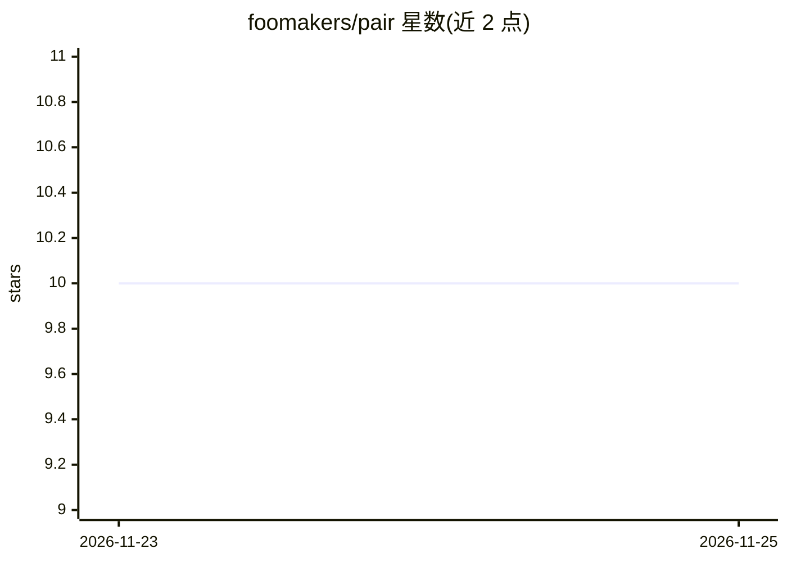

# foomakers/pair

⭐ 10 · JavaScript · MIT · 推送 2026-11-23 · [GitHub](https://github.com/foomakers/pair) · [官网](https://pair.foomakers.com) · 组织维护

**为 AI 编码助手提供团队知识库与技能的开发流程层**

通过 npm 安装 CLI 后，将知识库写入项目的 .pair/ 与 .claude/skills/ 目录，供 AI 编码助手读取，遵循团队的规范、流程与架构决策。内容包含覆盖 SDLC 各阶段的指南与模板、41 个符合 agentskills.io 开放标准的幂等 Agent Skills 工作流、项目级采纳文件（架构、技术栈、ADR）以及 llms.txt 机器可读索引。支持通过 pair.config.json 的 workflowProfiles 为各阶段配置执行引擎与模型，交付卡通过恢复预算与 resume token 支持断点续跑。Claude Code 用户可通过插件市场安装引导插件代替命令行。

## 筛选速览

| 维度 | 判定 | 备注 |
|---|---|---|
| AI 角色 | `ai-ecosystem` | LLM/agent 周边工具 |
| 许可风险 | `permissive` | MIT |
| 部署形态 | `library` | 以包/库形式分发 |
| 模型依赖 | locked-api |  |
| 硬件要求 | — | 无带数字的原话,不猜 |
| 安装摩擦 | `low` | 无编译、无系统依赖或容器化 |
| 成熟度 | — | 结构信号不足 |

## 能力要点

- 知识库：9 个 how-to 指南、9 个规范领域与提交/PR/ADR 模板
- 41 个遵循 agentskills.io 开放标准的幂等 Agent Skills 工作流
- workflowProfiles 配置各阶段引擎与模型（codex/claude 等 profile）
- .pair/llms.txt 提供 llmstxt.org 格式的机器可读索引

## 适用场景

- 让 AI 编码助手按团队已有规范和流程工作
- 为 SDLC 各阶段（PRD 到代码评审）配置不同的模型与引擎
- 以技能工作流形式固化实现、评审、质量门禁等流程

## 场景标签

 · 领域:软件开发工具/工程流程

## 证据(README 行号)

> L5: **AI-assisted software development** — structured Knowledge Base, Agent Skills, and adoption files that give AI codi
> L43: - **Agent Skills** — 41 idempotent workflows following the agentskills.io open standard
> L36: Set `workflowProfiles` in `pair.config.json` to choose each stage's engine and model. `run.defaults` and `run.agent

## 星数曲线

2026-11-23 10 → 2026-11-25 10（+0）

---
*卡片 v1 · prompt 1.4 · 生成 2026-11-23 · 置信度 high · 依据 README sha `add544ae8dca` · [字段定义](../../DATASET.md)*
