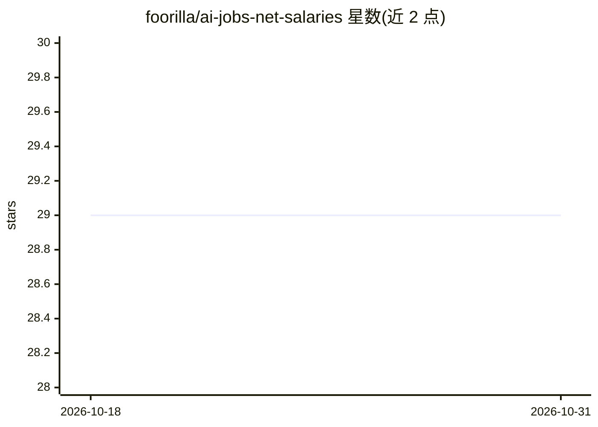

# foorilla/ai-jobs-net-salaries

⭐ 29 · CC0-1.0 · 推送 2026-03-01 · [GitHub](https://github.com/foorilla/ai-jobs-net-salaries) · [官网](https://aijobs.net/salaries) · 组织维护

**全球 AI/ML/大数据岗位薪资数据集（2021-2025）**

aijobs.net 通过匿名问卷调查收集的 AI/ML/大数据岗位全球薪资数据集，以每周快照形式发布，覆盖 2021-2025 年；另附从全球科技招聘信息聚合的近期薪资数据 API（foorilla.com/api/）。面向求职者、有经验从业者、招聘经理、猎头、创业者及转行人群，用于了解全球薪资水平并做决策。数据以 CC0 公共领域许可发布，可复制、修改、分发及商用，无需授权。

## 筛选速览

| 维度 | 判定 | 备注 |
|---|---|---|
| AI 角色 | `ai-knowledge` | 知识聚合/清单类 |
| 许可风险 | `viral` | CC0-1.0 |
| 部署形态 | `None` |  |
| 模型依赖 | — | README 未给出锁定关系 |
| 硬件要求 | — | 无带数字的原话,不猜 |
| 安装摩擦 | `low` | 无编译、无系统依赖或容器化 |
| 成熟度 | — | 结构信号不足 |

## 能力要点

- 匿名问卷调查来源的全球 AI/ML/大数据薪资周度快照
- 覆盖 2021-2025 年数据
- CC0 公共领域许可，可商用无需授权
- 另提供招聘信息聚合的薪资数据 API 入口

## 适用场景

- 求职或转行前了解目标岗位的全球薪资水平
- 招聘方与猎头制定薪资参考
- 做薪资相关的数据分析或研究

## 场景标签

`数据分析` · 领域:效率与自动化

## 证据(README 行号)

> L3: ## A dataset of global salaries in AI/ML and Big Data (2021 - 2025)
> L5: This repository is a weekly snapshot of all the AI/ML/Big Data salary data obtained anonymously through the survey a

## 星数曲线

2026-10-18 29 → 2026-10-31 29（+0）

---
*卡片 v1 · prompt 1.4 · 生成 2026-10-26 · 置信度 high · 依据 README sha `4c8df6697816` · [字段定义](../../DATASET.md)*
