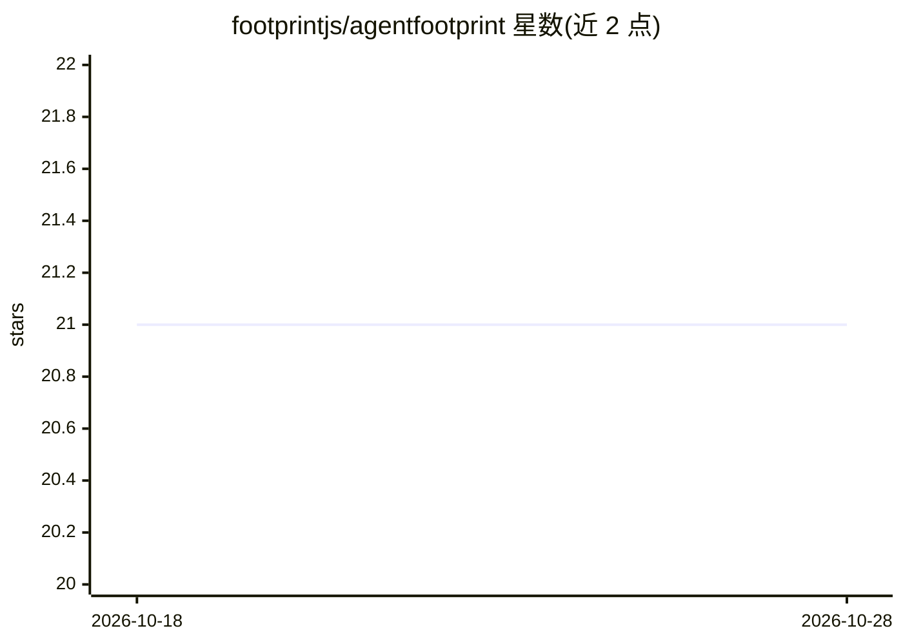

# footprintjs/agentfootprint

⭐ 21 · TypeScript · MIT · 推送 2026-10-27 · [GitHub](https://github.com/footprintjs/agentfootprint) · [官网](https://footprintjs.github.io/agentfootprint/) · 组织维护

**面向开发者的 TypeScript agent 框架：让回答可追溯到执行证据**

基于 FootprintJS 执行溯源的 TypeScript agent 构建框架。将 skills、steering、RAG、memory 等上下文抽象为「Injection = slot × trigger × cache」，3 个固定 LLM slot × 4 种触发器注入；运行时把上下文、工具调用、结果与决策记录为相连的执行记录，用于回答校验、调试与回放。提供 absent()/coverage()/answerValidation() 等可配置检查：工具声明缺失与覆盖边界、确定性检测无支撑数值，enforce 模式可扣留未通过校验的回答。支持 anthropic/openai/bedrock/gemini/ollama 及 mock provider，Quick start 离线运行无需 API key。README 明确框架不暴露模型内部推理，negativeClaims 等 特性未通过基准、标记不推荐。

## 筛选速览

| 维度 | 判定 | 备注 |
|---|---|---|
| AI 角色 | `ai-ecosystem` | LLM/agent 周边工具 |
| 许可风险 | `permissive` | MIT |
| 部署形态 | `library` | 以包/库形式分发 |
| 模型依赖 | local-ok | 支持本地模型 |
| 硬件要求 | — | 无带数字的原话,不猜 |
| 安装摩擦 | `low` | 无编译、无系统依赖或容器化 |
| 成熟度 | `idea` | |

## 能力要点

- Injection = slot × trigger × cache：上下文注入统一抽象，注入即被追踪
- absent()/coverage() 让工具声明的覆盖边界随回答传递
- answerValidation enforce 模式可扣留未通过校验的回答
- 支持 anthropic/openai/bedrock/gemini/ollama provider，quick start 离线运行无需 API key

## 适用场景

- 构建需要回答可审计、可回放证据链的 agent 应用
- 在回答交付前按应用自定规则校验并扣留无证据支撑的输出
- 调试 agent 运行：回放 trace、检查工具描述相似度

## 场景标签

`Agent 框架` `LLM 可观测性` · 领域:Agent 开发

## 证据(README 行号)

> L5:  A TypeScript agent framework for connecting answers to recorded evidence, making uncertainty explicit,
> L8:  Built on FootprintJS execution provenance:
> L144: Skills, steering, RAG, facts, memory, guardrails — every name for context does one thing: it injects into one of t

## 星数曲线

2026-10-18 21 → 2026-10-28 21（+0）

---
*卡片 v1 · prompt 1.4 · 生成 2026-10-28 · 置信度 high · 依据 README sha `c08ab50ba696` · [字段定义](../../DATASET.md)*
