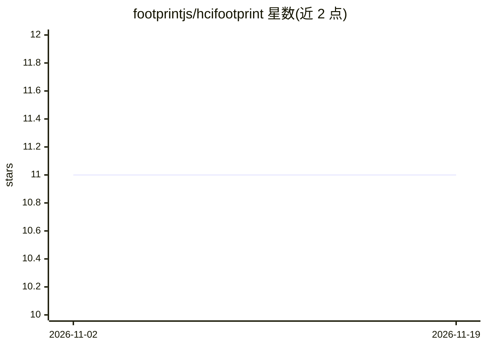

# footprintjs/hcifootprint

⭐ 11 · TypeScript · MIT · 推送 2026-11-18 · [GitHub](https://github.com/footprintjs/hcifootprint) · [官网](https://footprintjs.github.io/hcifootprint/) · 组织维护

**为 Web 应用声明 agent 可操作的动作与旅程图谱的 TypeScript 库**

hcifootprint 是一个 TypeScript 库，用于声明 Web 应用的动作（actions）与旅程（journeys），向 agent 提供动作的实时可用性并记录交互结果。开发者以声明式结构描述页面、动作、旅程，库从中派生动作间关系（如阻塞/解锁），并通过内置 MCP server 以四个固定工具（whats_here/why/do_action/did_it_work）向模型提供服务；所有操作以登录用户身份经前端已有按钮与权限执行。零依赖核心，MIT 许可，README 称有 3606 个测试通过。

## 筛选速览

| 维度 | 判定 | 备注 |
|---|---|---|
| AI 角色 | `ai-ecosystem` | LLM/agent 周边工具 |
| 许可风险 | `permissive` | MIT |
| 部署形态 | `library` | 以包/库形式分发 |
| 模型依赖 | — | README 未给出锁定关系 |
| 硬件要求 | — | 无带数字的原话,不猜 |
| 安装摩擦 | `low` | 无编译、无系统依赖或容器化 |
| 成熟度 | — | 结构信号不足 |

## 能力要点

- 声明式动作/旅程图谱，关系（阻塞、路径）从声明自动派生，无需编写边
- 内置真实 MCP server，向模型提供四个固定工具
- 记录交互结果与执行来源（human/agent/guard 三种 mover 归因）
- 零依赖核心，提供 fromRoutes/fromReactRouter 等既有路由结构导入

## 适用场景

- 让 AI agent 以登录用户身份操作自有的 Web 应用前端
- 压缩 agent 每轮所需的页面上下文 token 开销
- 在 CI 中 lint 并评审应用的动作图谱声明
- 追踪 agent 与人类操作的业务动作是否真正完成

## 场景标签

`Agent 框架` `浏览器自动化` · 领域:Agent 开发

## 证据(README 行号)

> L5:  A TypeScript library for declaring web-app actions and journeys, serving their live availability to agents, and rec
> L15:  serves a real MCP server

## 星数曲线

2026-11-02 11 → 2026-11-19 11（+0）

---
*卡片 v1 · prompt 1.4 · 生成 2026-11-18 · 置信度 high · 依据 README sha `19edf134c9ec` · [字段定义](../../DATASET.md)*
