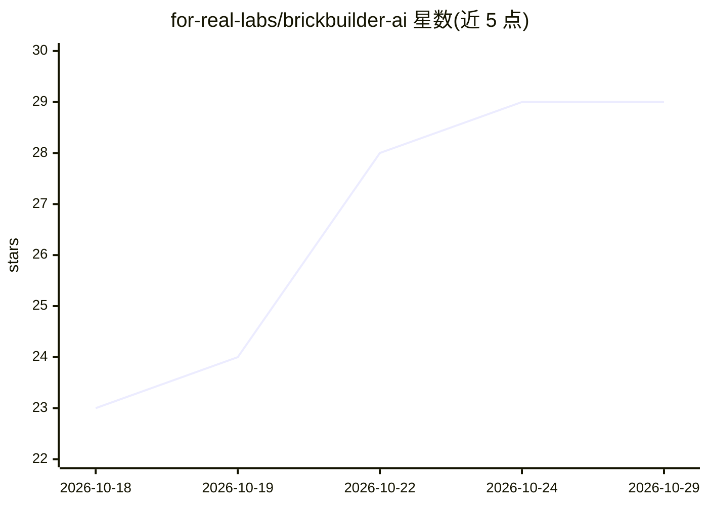

# for-real-labs/brickbuilder-ai

⭐ 29 · TypeScript · MIT · 推送 2026-10-28 · [GitHub](https://github.com/for-real-labs/brickbuilder-ai) · [官网](https://brickbuilder.ai) · 组织维护

**LEGO 搭建设计 agent：用 LLM 生成积木模型与搭建说明**

名为 Pip 的 LEGO 搭建 agent。用户用自然语言描述想要的作品或上传参考图，系统调用 LLM（OpenAI/Claude）在螺柱网格上设计模型，自动校验设计并交付 3D 预览、搭建步骤、零件清单与可下载的 LDraw 文件，支持迭代修改。提供两种模式：Basic bricks 用 OpenAI/Claude 模型设计基础砖块；All parts 由 Nova agent 在 Docker 中运行，可检索更大零件目录、编写搭建脚本并自检。可在 brickbuilder.ai 使用或本地运行（Node.js 18+/Python 3.10+/Git，All parts 需 Docker）。

## 筛选速览

| 维度 | 判定 | 备注 |
|---|---|---|
| AI 角色 | `ai-native` | 本体是模型或模型工具 |
| 许可风险 | `permissive` | MIT |
| 部署形态 | `library` | 以包/库形式分发 |
| 模型依赖 | locked-api |  |
| 硬件要求 | — | 无带数字的原话,不猜 |
| 安装摩擦 | `low` | 无编译、无系统依赖或容器化 |
| 成熟度 | — | 结构信号不足 |

## 能力要点

- 自然语言或参考图生成 LEGO 设计，输出 3D 预览/搭建说明/零件清单/LDraw 文件
- Basic bricks 与 All parts（Nova agent + 大零件目录 + Docker）两种模式
- 支持迭代修改并延续已有搭建
- 提供本地运行途径与 MIT 许可

## 适用场景

- 描述想法让 AI 设计乐高模型并拿到零件清单
- 上传参考图生成可搭建的积木设计
- 逐步修改设计直到满意

## 场景标签

`图像生成` · 领域:内容生成

## 证据(README 行号)

> L5: **A LEGO® building agent.** Tell Pip what you want to build, or give it a reference image. BrickBuilder uses an LLM 
> L11: |**Basic bricks**|An OpenAI or Claude model designs shapes on a stud grid. BrickBuilder checks the design, shows th

## 星数曲线

2026-10-18 23 → 2026-10-29 29（+6）

---
*卡片 v1 · prompt 1.4 · 生成 2026-10-26 · 置信度 high · 依据 README sha `255a529258d1` · [字段定义](../../DATASET.md)*
