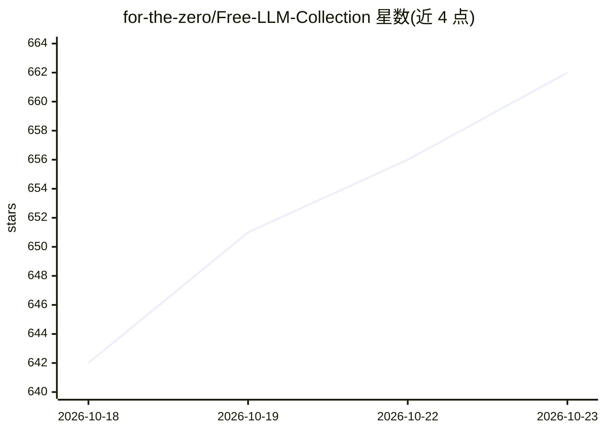

# for-the-zero/Free-LLM-Collection

⭐ 662 · 推送 2026-10-17 · [GitHub](https://github.com/for-the-zero/Free-LLM-Collection) · 个人维护 · 中文 README

**免费大模型 API 合集：汇集各平台 OpenAI 格式接口与精选模型**

个人维护的免费 LLM API 聚合清单：收录硅基流动、OpenRouter、Gemini、Groq、ModelScope、Cloudflare Workers AI 等 20 余个提供免费额度的 API 端点，逐条列出 API 地址、速率限制与推荐模型。入选原则为长期可用优先、限制请求速率而非 token、来源多、模型较新；仅收录 OpenAI 格式 API。条目来源为自行收集与他人投稿，另附排行榜参考链接。

## 筛选速览

| 维度 | 判定 | 备注 |
|---|---|---|
| AI 角色 | `ai-knowledge` | 知识聚合/清单类 |
| 许可风险 | `none` | — |
| 部署形态 | `None` |  |
| 模型依赖 | — | README 未给出锁定关系 |
| 硬件要求 | — | 无带数字的原话,不猜 |
| 安装摩擦 | `low` | 无编译、无系统依赖或容器化 |
| 成熟度 | — | 结构信号不足 |

## 能力要点

- 收录 20 余个免费 LLM API 端点及其速率限制
- 每条列出 API 地址、速率限制与推荐模型清单
- 仅收录 OpenAI 格式 API
- 以 Markdown 与 LLM 生成渲染的表格两种形式呈现

## 适用场景

- 寻找可白嫖的 OpenAI 格式免费 API 用于开发测试
- 对比各平台免费额度与速率限制后选择接入对象
- 为个人项目找到长期可用的免费模型来源

## 场景标签

`精选清单` · 领域:学习与行业

## 证据(README 行号)

> L3: 这是一个关于免费的大模型api的合集，并精选了一部分模型
> L9: 目前只接受提供了OpenAI格式的API
> L33: ### 硅基流动 / SiliconFlow

## 星数曲线

2026-10-18 642 → 2026-10-23 662（+20）

---
*卡片 v1 · prompt 1.4 · 生成 2026-10-21 · 置信度 high · 依据 README sha `645f66432cdf` · [字段定义](../../DATASET.md)*
