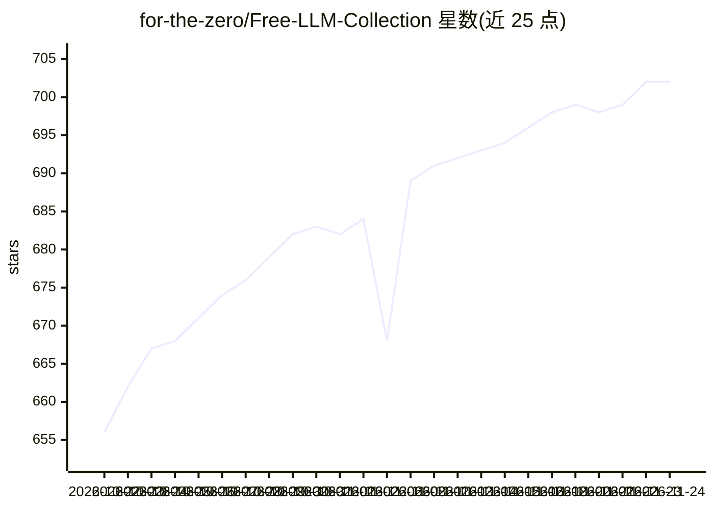

# for-the-zero/Free-LLM-Collection

⭐ 702 · TypeScript · 推送 2026-11-14 · [GitHub](https://github.com/for-the-zero/Free-LLM-Collection) · [官网](https://for-the-zero.github.io/Free-LLM-Collection/) · 个人维护 · 中文 README

**免费大模型 API 清单：收录可长期免费调用的接口**

一份按入选规则筛选的中英文双语清单，收录可长期免费使用、非一次性额度、速率限制可刷新且无需信用卡验证的大模型 API，条目涵盖 API 端点、速率限制与可用模型列表，含 ChatAnywhere、Groq、OpenRouter、讯飞星火等多个入口。数据以 flc.json 与 GitHub Pages 页面形式发布，维护者通过修改 providers/ 目录更新内容，接受 Issue 与 PR 投稿。

## 筛选速览

| 维度 | 判定 | 备注 |
|---|---|---|
| AI 角色 | `ai-knowledge` | 知识聚合/清单类 |
| 许可风险 | `none` | — |
| 部署形态 | `None` |  |
| 模型依赖 | — | README 未给出锁定关系 |
| 硬件要求 | — | 无带数字的原话,不猜 |
| 安装摩擦 | `low` | 无编译、无系统依赖或容器化 |
| 成熟度 | — | 结构信号不足 |

## 能力要点

- 按入选规则（长期免费、额度可刷新、无需信用卡）筛选条目
- 每条记录 API 端点、速率限制与可用模型列表
- 提供 flc.json 数据文件与 GitHub Pages 在线页面
- 通过 providers/ 目录维护，接受 Issue/PR 投稿

## 适用场景

- 寻找无需付费即可调用的 LLM API 入口
- 查询各免费通道的速率限制与可用模型
- 为个人项目挑选免费推理服务来源

## 场景标签

`精选清单` · 领域:学习与行业

## 证据(README 行号)

> L5: ## 入选规则 / Rules
> L21: ## Online & API

## 星数曲线

2026-10-22 656 → 2026-11-24 702（+46）

---
*卡片 v1 · prompt 1.4 · 生成 2026-11-24 · 置信度 high · 依据 README sha `8ab173d8de13` · [字段定义](../../DATASET.md)*
