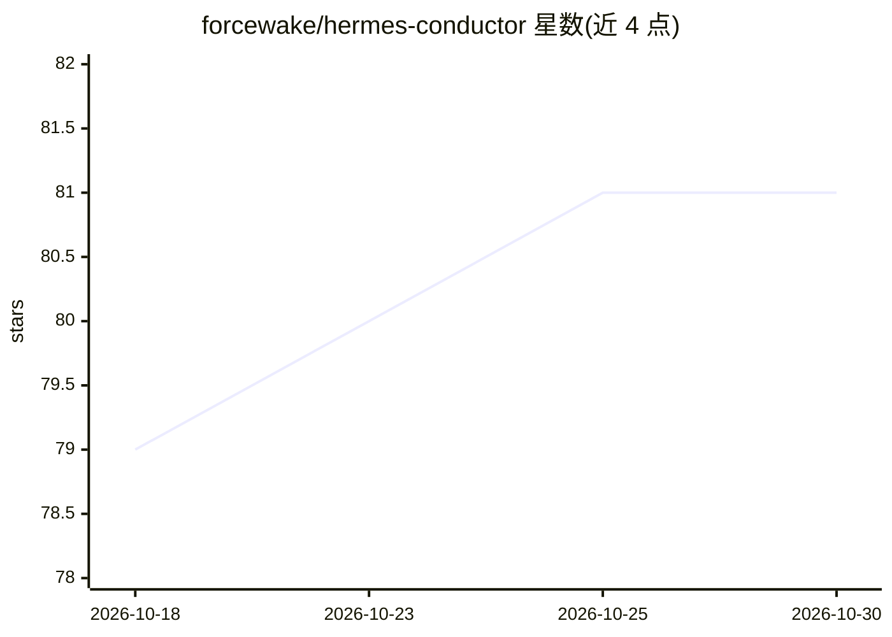

# forcewake/hermes-conductor

⭐ 81 · MIT · 推送 2026-08-25 · [GitHub](https://github.com/forcewake/hermes-conductor) · 个人维护

**用 Hermes kanban 控制器编排外部编码 CLI 的生产模式集**

面向 Hermes Agent 用户的编排模式与角色技能库：以单一 kanban 控制器调度 Claude Code、OpenCode、Codex CLI、MiMo、agy 等外部编码代理，内容提炼自 18 个生产看板与 367 张卡片。核心机制包括：控制器只路由不实现、外部代理自我报告不作为完成证据（控制器自行验证 worktree diff 并重跑测试）、每个变更车道使用独立 git worktree、完成须附 commit ID 与命令输出。提供 7 个编排模式文档与 2 个可通过 hermes skills install 安装的角色 playbook。要求 Hermes Agent v0.20+ 且启用 kanban dispatcher。

## 筛选速览

| 维度 | 判定 | 备注 |
|---|---|---|
| AI 角色 | `ai-ecosystem` | LLM/agent 周边工具 |
| 许可风险 | `permissive` | MIT |
| 部署形态 | `None` |  |
| 模型依赖 | — | README 未给出锁定关系 |
| 硬件要求 | — | 无带数字的原话,不猜 |
| 安装摩擦 | `low` | 无编译、无系统依赖或容器化 |
| 成熟度 | — | 结构信号不足 |

## 能力要点

- 7 个生产编排模式：worktree 车道、验证门禁、恢复清单
- 2 个可安装角色 playbook：kanban-orchestrator 与 kanban-worker
- 零信任自报机制：控制器验证 diff、重跑测试并以证据关单
- 支持 Claude Code / OpenCode / Codex / MiMo / agy 等多种编码 CLI 作车道执行器

## 适用场景

- 用看板控制器并行调度多个编码 CLI 完成开发任务
- 防止外部代理虚假完成报告污染主干分支
- 依赖链任务的顺序编排与过期车道恢复

## 场景标签

`多智能体` `编码 Agent` · 领域:Agent 开发

## 证据(README 行号)

> L5: Production orchestration patterns for running external coding agents — Claude Code, OpenCode, Codex CLI, MiMo, agy, 
> L59: 1. **The orchestrator never implements.** Its SOUL.md says: *"Do not implement. Do not research. Do not write code.
> L134: - Hermes Agent v0.20+ (kanban CLI + gateway dispatcher)

## 星数曲线

2026-10-18 79 → 2026-10-30 81（+2）

---
*卡片 v1 · prompt 1.4 · 生成 2026-10-24 · 置信度 high · 依据 README sha `c4d65924131c` · [字段定义](../../DATASET.md)*
