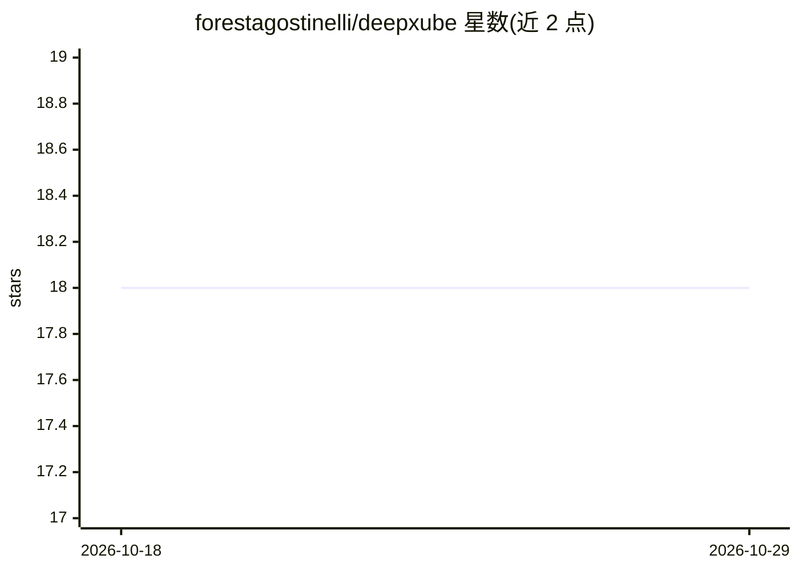

# forestagostinelli/deepxube

⭐ 18 · Python · MIT · 推送 2026-10-27 · [GitHub](https://github.com/forestagostinelli/deepxube) · [官网](https://forestagostinelli.github.io/deepxube/) · 个人维护

**以领域无关方式学习启发式函数解决寻路问题的 RL 库**

DeepXube（Deep Cube）结合深度强化学习与启发式搜索求解寻路问题：先用强化学习训练将状态-目标对映射为 cost-to-go 估计的启发式函数，再用批量加权 A*/Q* 搜索或束搜索求解问题实例。DeepCubeA 的泛化版本，支持自定义领域放入 ./domains/ 目录注册，支持自定义神经网络启发式、命令行工具 deepxube 完成实例生成、训练、求解与可视化，内置 grid 示例领域。以 pip 包发布。

## 筛选速览

| 维度 | 判定 | 备注 |
|---|---|---|
| AI 角色 | `ai-native` | 本体是模型或模型工具 |
| 许可风险 | `permissive` | MIT |
| 部署形态 | `library` | 以包/库形式分发 |
| 模型依赖 | — | README 未给出锁定关系 |
| 硬件要求 | — | 无带数字的原话,不猜 |
| 安装摩擦 | `low` | 无编译、无系统依赖或容器化 |
| 成熟度 | — | 结构信号不足 |

## 能力要点

- 用强化学习训练状态-目标的 cost-to-go 启发式函数
- 训练后启发式配合批量加权 A*/Q* 搜索与束搜索求解
- 用户自定义领域与神经网络启发式经目录递归导入注册
- deepxube 命令行覆盖实例生成、训练、求解与可视化

## 适用场景

- 为自己的状态空间问题训练启发式函数并加速搜索求解
- 研究启发式学习与 A*/Q* 搜索结合的效果
- 用内置 grid 领域快速验证安装与功能

## 场景标签

`强化学习` · 领域:训练与推理

## 证据(README 行号)

> L14: DeepXube (pronounced "Deep Cube") aims to solve pathfinding using a combination of deep reinforcement learning and 
> L16: 1) Learn a heuristic function that maps states and goals to an estimate of the cost-to-go from the given state to t
> L17: 2) Use the learned heuristic function with heuristic search algorithms, such as batch weighted A* search or batch w

## 星数曲线

2026-10-18 18 → 2026-10-29 18（+0）

---
*卡片 v1 · prompt 1.4 · 生成 2026-10-29 · 置信度 high · 依据 README sha `cf1075aaf2d9` · [字段定义](../../DATASET.md)*
