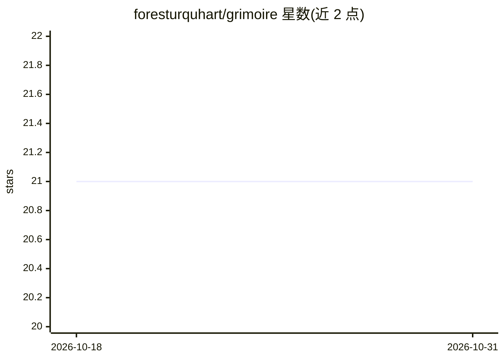

# foresturquhart/grimoire

⭐ 21 · Go · MIT · 推送 2025-11-27 · [GitHub](https://github.com/foresturquhart/grimoire) · 个人维护

**把目录内容转成 LLM 友好结构化输出的命令行工具**

用 Go 编写的 CLI 工具：递归扫描目录，将文件内容生成为 Markdown、XML 或纯文本输出，供 Claude、ChatGPT 等 LLM 解读。机制包括：Git 仓库内按提交频率排序文件、基于 gitleaks 的密钥检测与可选脱敏、tiktoken-go 估算 token 数、压缩文件识别与 .gitignore/.grimoireignore 忽略规则。提供安装脚本、预编译二进制与 go install 三种安装方式；Git 仅为使用 Git 排序时必需。

## 筛选速览

| 维度 | 判定 | 备注 |
|---|---|---|
| AI 角色 | `ai-ecosystem` | LLM/agent 周边工具 |
| 许可风险 | `permissive` | MIT |
| 部署形态 | `desktop` | 安装包/桌面程序 |
| 模型依赖 | — | README 未给出锁定关系 |
| 硬件要求 | — | 无带数字的原话,不猜 |
| 安装摩擦 | `low` | 无编译、无系统依赖或容器化 |
| 成熟度 | — | 结构信号不足 |

## 能力要点

- Markdown/XML/纯文本三种输出格式
- Git 提交频率排序与密钥检测/脱敏（gitleaks）
- 内置 token 计数与压缩文件高 token 警告
- 支持 .gitignore 与 .grimoireignore 忽略规则

## 适用场景

- 把代码仓库整理成单个文件喂给 LLM 分析
- 向 AI 助手提问前确认内容不超出上下文限制
- 生成输出前防止 API 密钥等敏感信息泄露

## 场景标签

 · 领域:开发者工具/LLM 输入准备

## 证据(README 行号)

> L11: Grimoire is a command-line tool that converts the contents of a directory into structured output formats optimized 
> L40: * **Git Integration:** Prioritizes files by commit frequency when working within a Git repository.
> L43: * **Token Counting:** Calculates the token count of generated output to help manage LLM context limits.

## 星数曲线

2026-10-18 21 → 2026-10-31 21（+0）

---
*卡片 v1 · prompt 1.4 · 生成 2026-10-28 · 置信度 high · 依据 README sha `b46a31eae203` · [字段定义](../../DATASET.md)*
