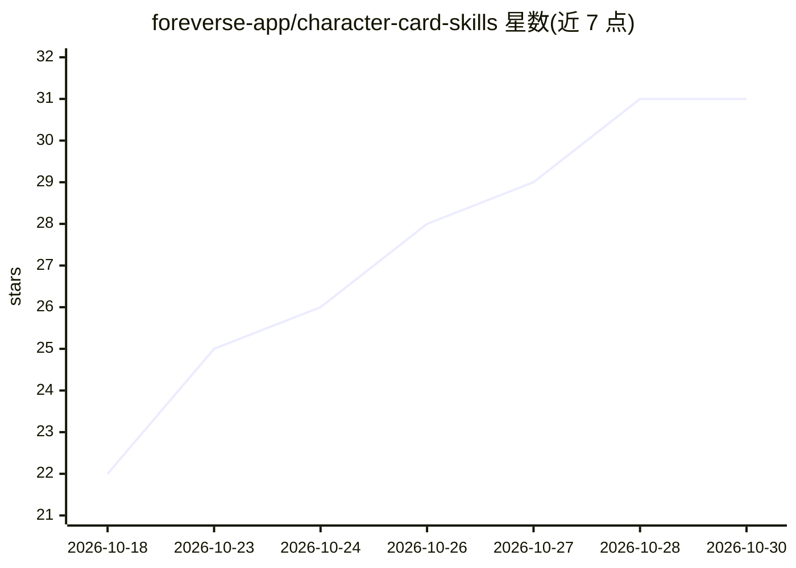

# foreverse-app/character-card-skills

⭐ 31 · Python · NOASSERTION · 推送 2026-07-26 · [GitHub](https://github.com/foreverse-app/character-card-skills) · [官网](https://foreverse.app) · 组织维护 · 中文 README

**角色卡作者的 agent 技能包、原创角色卡与 AI 腔调检测工具**

面向角色扮演卡作者的仓库：提供 4 个 SKILL.md 格式的 agent 技能（中文/英文双套创作技能、聊天质量诊断技能、语料风格模仿技能），可在 Claude Code、Cursor、Codex、Gemini CLI 及 Foreverse 应用内运行；附 18 张原创角色卡（v2 JSON + v3 PNG，可导入 SillyTavern 等前端）与一套 Python 3.9+ 无第三方依赖的确定性工具：8 维评分器、AI 腔调扫描、md 转卡转换器与盲评框架。中英文技能分别基于各自社区数据校准，规则在多处互相矛盾。

## 筛选速览

| 维度 | 判定 | 备注 |
|---|---|---|
| AI 角色 | `ai-knowledge` | 知识聚合/清单类 |
| 许可风险 | `none` | NOASSERTION |
| 部署形态 | `None` |  |
| 模型依赖 | — | README 未给出锁定关系 |
| 硬件要求 | — | 无带数字的原话,不猜 |
| 安装摩擦 | `low` | 无编译、无系统依赖或容器化 |
| 成熟度 | — | 结构信号不足 |

## 能力要点

- 中英文双套角色卡创作技能，各自基于本语言社区数据校准
- 确定性 AI 腔调检测器与 8 维评分器（Python 3.9+，零第三方依赖）
- 18 张原创角色卡以 v2 JSON + v3 PNG 双格式交付，兼容 chara_card_v2/v3 前端
- CI 对每张卡跑评分门槛、检测器回归与转换往返验证

## 适用场景

- 在 Claude Code / Cursor 等 agent 中按流派方法论创作角色卡
- 检测自己写的卡是否存在 AI 腔调并做删改手术
- 直接导入现成角色卡到 SillyTavern 或 Foreverse 使用

## 场景标签

 · 领域:AI 角色play/创作工具

## 证据(README 行号)

> L3: Agent skills, 18 original character cards, and calibrated AI-flavor detectors for roleplay card authors — including,
> L16: |`skills/character-card-author/`|The Chinese-native authoring skill: four-axis positioning → 47 genre playbooks → f
> L21: |`tools/`|`score_card.py` (8-dimension scorer, zh calibration) · `score_card_en.py` (8-dimension scorer, English ca

## 星数曲线

2026-10-18 22 → 2026-10-30 31（+9）

---
*卡片 v1 · prompt 1.4 · 生成 2026-10-26 · 置信度 high · 依据 README sha `e91f0ac61343` · [字段定义](../../DATASET.md)*
