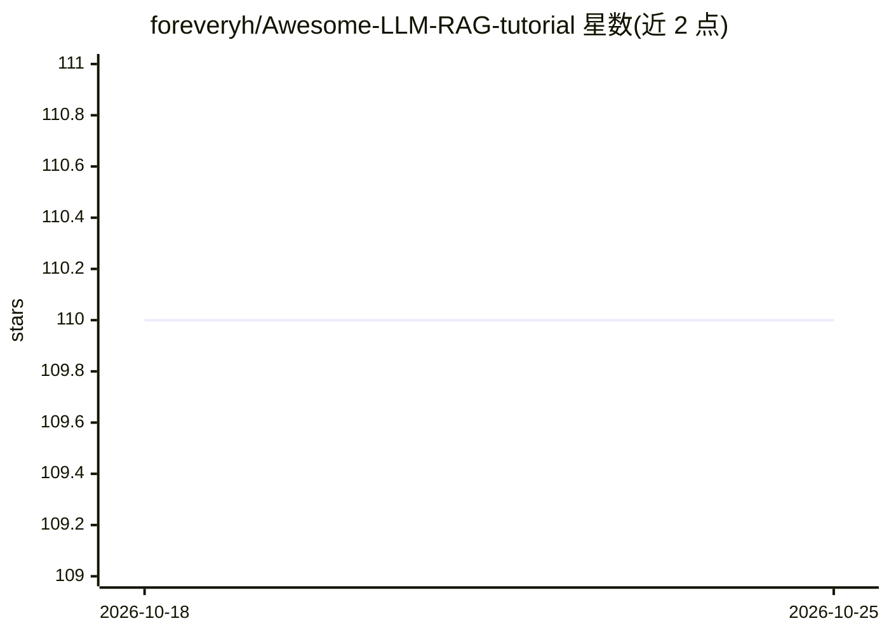

# foreveryh/Awesome-LLM-RAG-tutorial

⭐ — · [GitHub]() · 个人维护

**RAG 系列教程文档站：基于 Fumadocs 的教学内容**

Deeptoai 系列 RAG 教程的文档项目：基于 Fumadocs 框架与 Next.js 构建，文档以 MDX 格式存放于 /content/docs/，支持 KaTeX 数学公式渲染，通过 pnpm 安装依赖并运行开发服务器在本地浏览。README 仅描述文档站结构与写作规范（frontmatter、图片路径、构建缓存清理），未展示教程内容本身；面向学习 RAG 的读者与文档贡献者。

## 筛选速览

| 维度 | 判定 | 备注 |
|---|---|---|
| AI 角色 | `ai-knowledge` | 知识聚合/清单类 |
| 许可风险 | `none` | — |
| 部署形态 | `library` | 以包/库形式分发 |
| 模型依赖 | — | README 未给出锁定关系 |
| 硬件要求 | — | 无带数字的原话,不猜 |
| 安装摩擦 | `low` | 无编译、无系统依赖或容器化 |
| 成熟度 | — | 结构信号不足 |

## 能力要点

- 基于 Fumadocs + Next.js 的文档站点
- MDX 格式内容组织与 KaTeX 数学公式支持
- 提供新增文档的写作与文件结构规范

## 适用场景

- 学习 RAG 相关系列教程内容
- 为教程站添加或迁移新的文档章节

## 场景标签

`教程课程` · 领域:学习与行业

## 证据(README 行号)

> L1: # RAG Tutorial Project
> L3: This project uses the Fumadocs framework for documentation.

## 星数曲线

2026-10-18 110 → 2026-10-25 110（+0）

---
*卡片 v1 · prompt 1.4 · 生成 2026-10-23 · 置信度 mid · 依据 README sha `6a13f9337307` · [字段定义](../../DATASET.md)*
