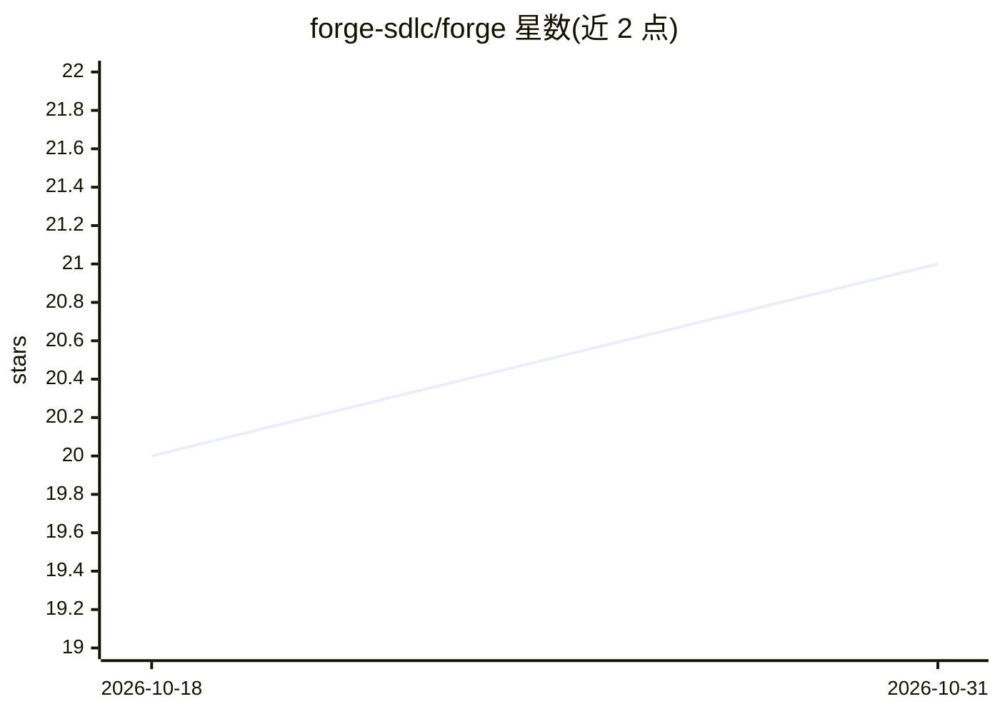

# forge-sdlc/forge

⭐ 21 · Python · MIT · 推送 2026-10-29 · [GitHub](https://github.com/forge-sdlc/forge) · [官网](https://forge-sdlc.github.io/forge/) · 组织维护

**把 Jira 工单自动转为人工评审 PR 的 AI 交付编排系统**

面向工程团队的软件交付生命周期编排系统：从 Jira 工单出发，生成 PRD、行为规格与实施计划，经人工审批后在临时 Podman 容器中实现代码，创建 GitHub PR、修复 CI 失败并等待人工评审后合并。支持跨仓库规划、审批门、可恢复检查点与 Prometheus/Langfuse/Grafana 可观测性。模型层基于 Deep Agents 与 LangChain chat model，内置 Anthropic API 与 Google Vertex AI 支持，可扩展到任意 LangChain 兼容模型。本地运行需 Python 3.11+、Redis Stack、Podman、Jira/GitHub 访问。

## 筛选速览

| 维度 | 判定 | 备注 |
|---|---|---|
| AI 角色 | `ai-ecosystem` | LLM/agent 周边工具 |
| 许可风险 | `permissive` | MIT |
| 部署形态 | `None` |  |
| 模型依赖 | — | README 未给出锁定关系 |
| 硬件要求 | — | 无带数字的原话,不猜 |
| 安装摩擦 | `low` | 无编译、无系统依赖或容器化 |
| 成熟度 | — | 结构信号不足 |

## 能力要点

- Jira 工单 → 人工审批计划 → 容器化实现 → GitHub PR → CI 修复 → 人工评审的完整流程
- 跨仓库规划与 repo 级任务分解
- 审批门、效果日志与可恢复检查点，Jira/GitHub 中可审计
- Prometheus 指标、Langfuse 追踪与 Grafana 面板

## 适用场景

- 让 AI 参与从需求到合并 PR 的交付流程但保留人工控制点
- 跨多仓库的功能与缺陷修复自动化
- 需要审批与审计的团队级 AI 编码工作流

## 场景标签

`工作流自动化` `编码 Agent` · 领域:效率与自动化

## 证据(README 行号)

> L43: Forge is built on Deep Agents and passes agents a LangChain chat model instance.
> L45: The built-in model factory supports direct Anthropic API credentials and Google Vertex AI-backed models. Because th
> L31: Forge connects Jira, GitHub, and AI coding agents into one event-driven workflow:

## 星数曲线

2026-10-18 20 → 2026-10-31 21（+1）

---
*卡片 v1 · prompt 1.4 · 生成 2026-10-28 · 置信度 high · 依据 README sha `dae34bacdd62` · [字段定义](../../DATASET.md)*
