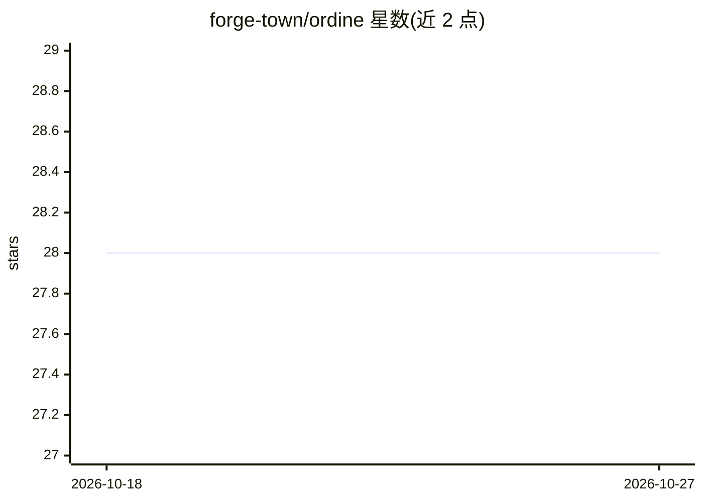

# forge-town/ordine

⭐ 28 · TypeScript · MIT · 推送 2026-10-07 · [GitHub](https://github.com/forge-town/ordine) · [官网](https://ordine.ai) · 组织维护 · 中文 README

**AI Agent 优先的工作编排框架：定义 DAG 流水线由 agent 执行**

TypeScript 编写的开源 AI Agent 编排框架：将操作定义为带类型的原子任务，组合成 DAG 流水线，可选择任意 AI agent（Claude、GPT、Gemini 或自建 agent）或脚本执行器运行；内置代码质量自动化插件，支持后台任务跟踪（进度与 traces）及通过插件扩展对象类型与领域工作流。以 monorepo 源码形式提供，通过 bun 安装依赖并运行 app 与 API server。当前处于 Preview 阶段，API 与数据模型在 beta 前可能变更。

## 筛选速览

| 维度 | 判定 | 备注 |
|---|---|---|
| AI 角色 | `ai-ecosystem` | LLM/agent 周边工具 |
| 许可风险 | `permissive` | MIT |
| 部署形态 | `None` |  |
| 模型依赖 | — | README 未给出锁定关系 |
| 硬件要求 | — | 无带数字的原话,不猜 |
| 安装摩擦 | `low` | 无编译、无系统依赖或容器化 |
| 成熟度 | `idea` | |

## 能力要点

- 操作组合为 DAG 流水线，agent 作为主要运行时
- 执行器可插拔：Claude/GPT/Gemini/自建 agent 或脚本
- Jobs 跟踪后台执行进度与 traces
- 插件机制扩展对象类型、操作与领域工作流

## 适用场景

- 把代码质量检查等重复流程定义为可复用的流水线
- 让任意 AI agent 按编排好的 DAG 工作流自动执行任务
- 以插件形式接入自有业务领域的操作类型

## 场景标签

`工作流自动化` `Agent 框架` · 领域:Agent 开发

## 证据(README 行号)

> L7: The open-source AI Agent first work orchestration framework.
> L21: Ordine is an **AI Agent first work Orchestration framework** that lets you define typed operations, compose them in
> L23: No more scattered scripts. No more babysitting agent runs. Define your workflow once as a pipeline — then let Claud

## 星数曲线

2026-10-18 28 → 2026-10-27 28（+0）

---
*卡片 v1 · prompt 1.4 · 生成 2026-10-26 · 置信度 high · 依据 README sha `2a80d837a9e5` · [字段定义](../../DATASET.md)*
