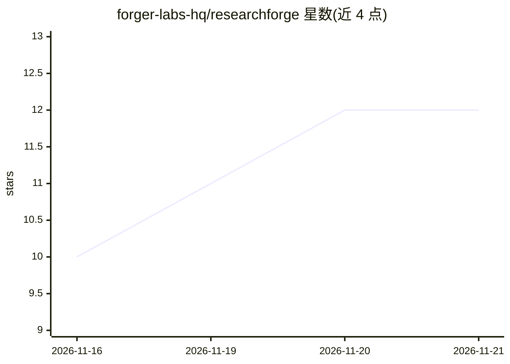

# forger-labs-hq/researchforge

⭐ 12 · Python · Apache-2.0 · 推送 2026-11-20 · [GitHub](https://github.com/forger-labs-hq/researchforge) · [官网](https://www.researchforgehq.com/) · 个人维护

**让 coding agent 隔夜跑实验的协议：冻结基线只留改进**

ResearchForge 是一个驱动 Claude Code、Cursor 或 API 模型做自动实验的 Python 工具：为仓库或 Kaggle 竞赛冻结基线，AI 每轮提出假设并在隔离的 git worktree 中运行、对照基线评分，保留胜出项并记录失败原因。支持终端 API key 或 Ollama 本地模型驱动、后台 auto-run 调度（launchd/systemd/Task Scheduler）、ntfy 手机通知与本地仪表盘；任何提交或发布均需人工批准。要求 Python 3.12+ 与 git。

## 筛选速览

| 维度 | 判定 | 备注 |
|---|---|---|
| AI 角色 | `ai-native` | 本体是模型或模型工具 |
| 许可风险 | `permissive` | Apache-2.0 |
| 部署形态 | `library` | 以包/库形式分发 |
| 模型依赖 | local-ok | 支持本地模型 |
| 硬件要求 | — | 无带数字的原话,不猜 |
| 安装摩擦 | `medium` | 含编译或系统依赖之一 |
| 成熟度 | — | 结构信号不足 |

## 能力要点

- 冻结基线 + 每轮对照评分，只保留验证过的改进
- 实验在独立 git worktree 中运行，不触碰用户检出
- Claude Code / Cursor / API key / Ollama 本地模型四种驱动方式
- Kaggle 每小时检查公开 notebook 并合并为新一轮

## 适用场景

- 睡前挂上 Kaggle 竞赛，自动跟随排行榜并尝试改进
- 给仓库定义一个指标（如 F1），隔夜自动跑实验并出晨报
- 无编辑器环境下用终端加本地模型运行实验循环

## 场景标签

`编码 Agent` `科研工具` · 领域:编码与开发

## 证据(README 行号)

> L7:  Give it a Kaggle competition or your repository before bed. On Kaggle it keeps your score current: every hour it fi
> L64: |**Every round**|The AI proposes one change → it runs on your chosen GPU, or in an isolated copy of your repo → it'
> L130: 5. Type `/researchforge-autorun`. Each round it plans experiments, you approve the first batch, and they run in se

## 星数曲线

2026-11-16 10 → 2026-11-21 12（+2）

---
*卡片 v1 · prompt 1.4 · 生成 2026-11-19 · 置信度 high · 依据 README sha `1e1f25dd4352` · [字段定义](../../DATASET.md)*
