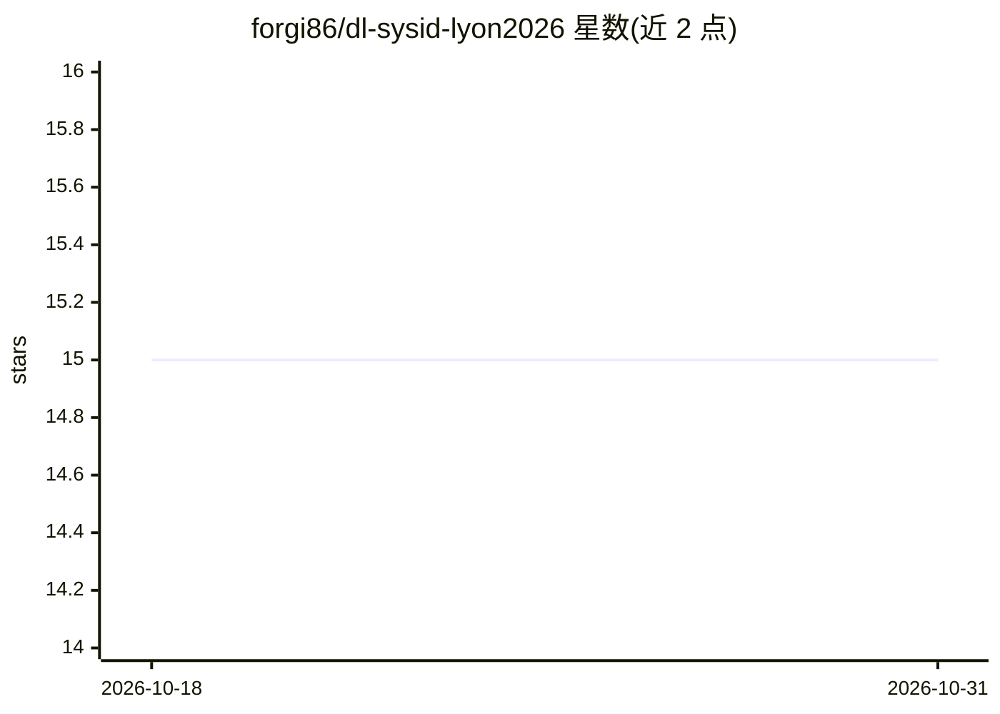

# forgi86/dl-sysid-lyon2026

⭐ 15 · Jupyter Notebook · MIT · 推送 2026-04-25 · [GitHub](https://github.com/forgi86/dl-sysid-lyon2026) · [官网](https://spring-id-2026.sciencesconf.org/resource/page/id/3) · 个人维护

**深度学习系统辨识短期课程的教学材料（讲义+笔记本）**

2026 年里昂春季学校短期课程 Deep Learning for System Identification 的配套仓库，包含课程幻灯片、可批注讲义、Jupyter Notebook 练习代码及生成幻灯片的 Quarto 源文件。面向有基础 Python/NumPy/Matplotlib 知识的参与者，要求 Python 3.14 并通过 Conda 环境安装依赖；代码示例设计为尽量简单，便于使用其他数值软件的用户跟学。本地 Jupyter 为推荐方式，也可用 Google Colab 打开示例。

## 筛选速览

| 维度 | 判定 | 备注 |
|---|---|---|
| AI 角色 | `ai-knowledge` | 知识聚合/清单类 |
| 许可风险 | `permissive` | MIT |
| 部署形态 | `library` | 以包/库形式分发 |
| 模型依赖 | — | README 未给出锁定关系 |
| 硬件要求 | — | 无带数字的原话,不猜 |
| 安装摩擦 | `low` | 无编译、无系统依赖或容器化 |
| 成熟度 | — | 结构信号不足 |

## 能力要点

- 课程幻灯片与便于批注的讲义版本
- Jupyter Notebook 形式的练习代码
- Quarto 源文件生成幻灯片
- 提供 Conda 环境配置与 Google Colab 备选运行方式

## 适用场景

- 跟随课程学习深度学习系统辨识方法
- 动手运行配套的 Notebook 练习
- 查看讲义幻灯片复习课程内容

## 场景标签

`教程课程` · 领域:学习与行业

## 证据(README 行号)

> L3: This repository contains the material for the mini-course **Deep Learning for System Identification**, held in Lyon 
> L29: 4. **Run examples in Jupyter:** All course examples are provided as Jupyter Notebooks. To run them, first navigate 
> L50: ├── slides/       # Slides of the lectures

## 星数曲线

2026-10-18 15 → 2026-10-31 15（+0）

---
*卡片 v1 · prompt 1.4 · 生成 2026-10-30 · 置信度 high · 依据 README sha `dc53d87bc931` · [字段定义](../../DATASET.md)*
