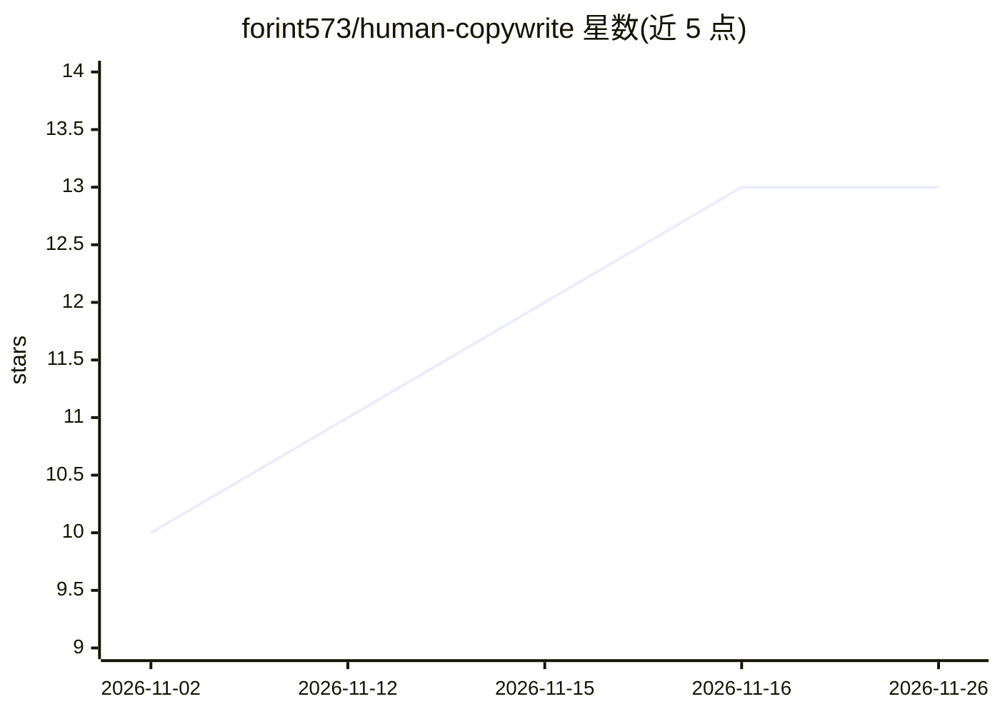

# forint573/human-copywrite

⭐ 13 · Python · Apache-2.0 · 推送 2026-07-11 · [GitHub](https://github.com/forint573/human-copywrite) · 个人维护

**Claude 技能：去除 AI 痕迹的营销与长文案改写器**

一个 Claude Agent Skill，用于撰写与改写营销和网站文案（落地页、销售页、电子书、案例、创始人随笔）。核心机制包括：聊天记录只作素材不作为文案的 transcript 规则、30+ 条 AI 痕迹目录的分级修改标准、事实防火墙（不编造证据、缺失细节输出占位符并标记 Verify）、以及通过 MY_OWN_VOICE.md 建立项目级个人文风。提供 make portable 生成的单文件版本用于任意系统提示词场景，并带 model-eval 评测脚本。输出为供人工润色的模板而非直接发布稿。

## 筛选速览

| 维度 | 判定 | 备注 |
|---|---|---|
| AI 角色 | `ai-native` | 本体是模型或模型工具 |
| 许可风险 | `permissive` | Apache-2.0 |
| 部署形态 | `None` |  |
| 模型依赖 | locked-api |  |
| 硬件要求 | — | 无带数字的原话,不猜 |
| 安装摩擦 | `low` | 无编译、无系统依赖或容器化 |
| 成熟度 | — | 结构信号不足 |

## 能力要点

- 聊天记录不直接作为文案，从会话提取的 source sheet 按读者问题顺序撰写
- 30+ 条 AI 痕迹目录按 always-fix/cluster-fix/context 分级处理
- 事实完整性约束：不编造证明、缺失细节生成 [ADD VERIFIED METRIC] 类占位符
- make portable 打包单文件，可在接受系统提示词的任何模型上使用

## 适用场景

- 让 AI 写的落地页读起来不像 AI 生成
- 会话结束后基于工作内容生成官网文案
- 在便宜的中文模型上通过系统提示词获得同等的改写规范

## 场景标签

`AI 写作` `提示工程` · 领域:Agent 开发

## 证据(README 行号)

> L5: **A human copywriter for Claude. It writes and de-slops marketing and website copy: no AI tells, no chat history lea
> L44: - **The transcript rule.** Chat history never ships as copy. Site prose is written from a source sheet (reader, pro
> L65: `make portable` builds `dist/human-copywrite-portable.md`: the whole skill as one file, for anything that takes a s

## 星数曲线

2026-11-02 10 → 2026-11-26 13（+3）

---
*卡片 v1 · prompt 1.4 · 生成 2026-11-18 · 置信度 high · 依据 README sha `27cd5490c998` · [字段定义](../../DATASET.md)*
