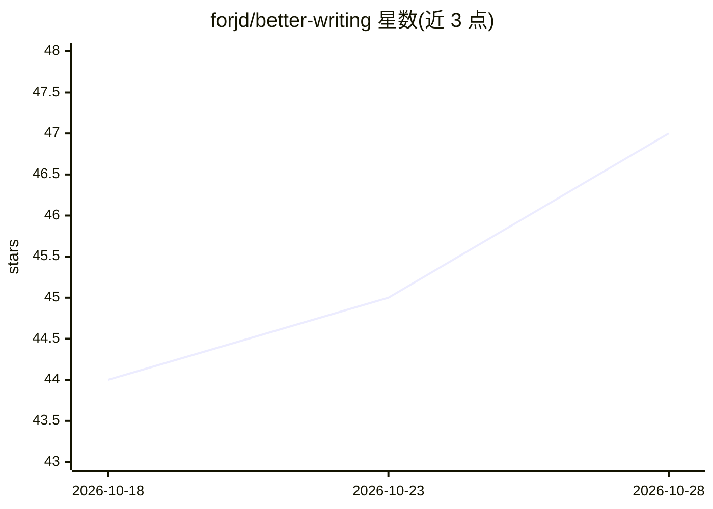

# forjd/better-writing

⭐ 49 · Python · MIT · 推送 2026-10-07 · [GitHub](https://github.com/forjd/better-writing) · [官网](https://skills.sh/forjd/better-writing) · 个人维护

**让 agent 改写文稿的技能：去 AI 腔、保留事实与作者声音**

面向读取技能的编码 agent（Claude Code、Codex、Cursor 等）的 SKILL.md 格式技能，用于改写、起草与审校散文：识别 AI 写作痕迹（意义膨胀、模糊归因、套路结论、slop 结构），以用户写作样本为风格基准，按体裁调节 directness/warmth 等参数；缺失事实以占位符标注而非编造。明确不以通过 AI 检测器为目标。附带评测工具链（fixtures、checker、模型 runner）。通过 skills.sh CLI、Claude Code 插件市场或手动复制安装。

## 筛选速览

| 维度 | 判定 | 备注 |
|---|---|---|
| AI 角色 | `ai-ecosystem` | LLM/agent 周边工具 |
| 许可风险 | `permissive` | MIT |
| 部署形态 | `library` | 以包/库形式分发 |
| 模型依赖 | — | README 未给出锁定关系 |
| 硬件要求 | — | 无带数字的原话,不猜 |
| 安装摩擦 | `low` | 无编译、无系统依赖或容器化 |
| 成熟度 | — | 结构信号不足 |

## 能力要点

- 以用户写作样本为风格基准，按体裁调节语气参数
- 缺失事实以占位符标注，禁止编造数字/轶事
- 识别 AI 写作痕迹与 slop 结构，含置信分级与误报清单
- 附带评测工具链：fixtures、checker、模型 runner 与对照基线

## 适用场景

- 让编码 agent 把 AI 腔的邮件/报告/文案改得更直接具体
- 以自己的写作样本为参照改写文章而不磨平个人风格
- 审校落地页、发布说明等文案中的泛化表达

## 场景标签

`AI 写作` · 领域:内容生成

## 证据(README 行号)

> L3: An agent skill for prose that sounds clear, specific, and human.
> L36: Better Writing is an agent skill for rewriting, drafting, and reviewing prose. Most de-slop skills delete AI tells 
> L209: |skills/better-writing/|The skill. skills.sh and manual installs copy this folder only.|

## 星数曲线

2026-10-18 44 → 2026-10-28 47（+3）

---
*卡片 v1 · prompt 1.4 · 生成 2026-10-25 · 置信度 high · 依据 README sha `85a79fdcc5ae` · [字段定义](../../DATASET.md)*
